# Mood Keys — Batch 12 immagini (Gemini, 2026-10-25)

Round-1 del protocollo: 4 mood × 3 scene, ognuna creatura+luogo+reliquia+archetipo compositivo. Ref-image del mood allegata a ogni submit. Cattura verificata per incremento del conteggio immagini (fix del runner dopo batch fallita con 8/12 duplicati).

## Verdetto sintetico

| Entry | Archetipo | Ref | Verdetto |
|---|---|---|---|
| rude-beauty-shepherd-shrine | MONOLITH | villaggio.png | PASS |
| rude-beauty-gorge-bridge | CASCADE | villaggio.png | PASS |
| rude-beauty-harvest-waystone | VISTA | villaggio.png | PASS |
| impero-solare-sun-forge | TABLEAUX | architettura impero sole.png | PASS |
| impero-solare-gold-aqueduct | CASCADE | architettura impero sole.png | PASS/WEAK |
| impero-solare-processional-stair | GRID | architettura impero sole.png | PASS |
| prismatic-frontier-crystal-aqueduct | ARCH | prismatic monumental gate.png | PASS |
| prismatic-frontier-observatory-dome | MONOLITH | prismatic monumental gate.png | PASS |
| prismatic-frontier-beacon-tower | ISLAND | prismatic monumental gate.png | PASS |
| dark-wasteland-siege-skeleton | VOID | verso mordor.png → mordor_clean.png (firma rimossa) | PASS (v2, no-ref) |
| dark-wasteland-obsidian-fortress | MONOLITH | verso mordor.png → mordor_clean.png (firma rimossa) | PASS (v2, no-ref) |
| dark-wasteland-banner-field | GRID | verso mordor.png → mordor_clean.png (firma rimossa) | PASS (v2, ref pulita) |

## Fallimento sistematico trovato e corretto

Le 3 dark-wasteland v1 riportavano la firma dipinta **"JONES"** in basso a destra: la copiavano dal ref `verso mordor.png` che la porta nel corner. La kill-list `no signatures` non basta quando la firma è **dentro il reference**.

**Correzione a campo singolo**: ref croppata (`mordor_clean.png`, -22% banda inferiore) + kill rafforzata (`NO artist signature or painted name/initials mark anywhere including corners`). v2 tutte pulite. Lezione: **preflight dei ref-image** — ispezionare i corner per firme prima di usarli come style-reference; aggiungere al form v2 un check `REF-CLEAN`.

**Nota collaterale**: 2/3 v2 sono uscite **senza** ref (attach timeout) e restano in-mood — il prompt testuale regge da solo su dark-wasteland.

## Dettaglio per scena

### rude-beauty-shepherd-shrine — MONOLITH — PASS

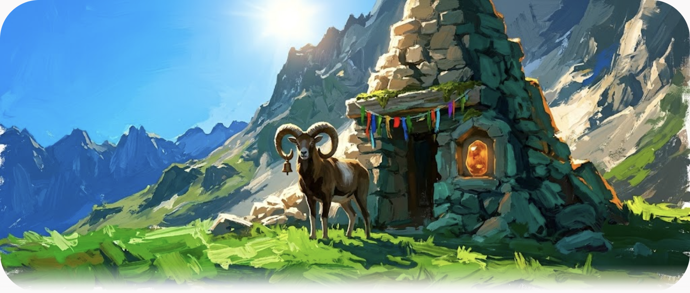

**Giudizio**: Cairn-shrine eroico right-of-center, muflone con campana al corno a sx, reliquario d'ambra che glowa nella nicchia. Shafts Solar Triumph, veronese+ambrato.

**Prompt**:
```
Using the attached reference image for STYLE, PALETTE and PAINTING TECHNIQUE only (not its content), paint a new fantasy scene.

SUBJECT — one complete composition containing exactly these three inhabitants: CREATURE: a great-horned mountain MOUFLON with a small bronze votive-bell hanging from one horn, standing calm and monumental. PLACE: a shepherd shrine: a rough stone cairn chapel built into the mountainside, votive ribbons and moss on its lintel. OBJECT: an amber reliquary — a fist-sized translucent amber stone glowing softly, set into the shrine's front niche.

COMPOSITION — MONOLITH composition: the cairn-shrine rises as a single hero-mass slightly right of center, the mouflon silhouetted against it at its base left, low alpine meadow in the foreground third, one distant ridgeline closing the top; clear negative space of luminous sky upper-left. Read as a deliberate cinematic shot with clear foreground/midground/background and focal hierarchy; the creature gives scale, the object reads as the signature detail.

STYLE: RUDE BEAUTY key — weathered alpine wilderness, tactile rude matter, moss-thick bark and alpine stone; painted in heavy oil impasto, Jaime Jones broad palette-knife strokes on stone and bark, Jeff Easley weight. PALETTE: veronese-green foliage dominant, ultramarine depth, amber light accents, ONE crimson pigment accent, deep teal-emerald shadows — never grey, never brown mud. LIGHT: Solar Triumph white-gold sun breaking through in shafts; luminous, high-chroma, never murk.

KILL LIST: no text, no signatures, no watermarks, no logos, no UI, no modern objects, no grey or brown shadow mud, no murk, no flat digital airbrush look, no symmetrical centered composition, no duplicated subjects, no extra creatures beyond the one specified.

Wide 21:9 cinematic format, one painted canvas.
```

### rude-beauty-gorge-bridge — CASCADE — PASS

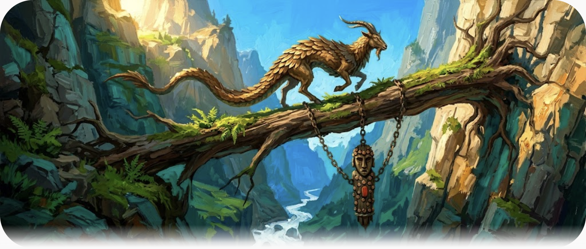

**Giudizio**: Capra-serpente scaglie-piume bronzo sul ponte-quercia, idolo legno+rame appeso sotto su catene. Diagonale CASCADE leggibile.

**Prompt**:
```
Using the attached reference image for STYLE, PALETTE and PAINTING TECHNIQUE only (not its content), paint a new fantasy scene.

SUBJECT — one complete composition containing exactly these three inhabitants: CREATURE: a bronze-feathered goat-serpent — a sure-footed alpine beast with overlapping bronze-gold feathered scales down its spine — mid-step on the bridge. PLACE: a living oak-bridge: a single enormous fallen oak that spans a mountain gorge, its roots still gripping the far cliff, moss and ferns growing along its back. OBJECT: a carved wooden idol studded with small copper discs, hung beneath the bridge on chains — a river-god offering.

COMPOSITION — CASCADE composition: the gorge drops diagonally from upper-left to lower-right, the oak-bridge crossing it as a counter-diagonal in the middle third, the beast traversing left-to-right, the idol dangling into the shadowed gorge below, rushing white water threading the bottom, cliff walls stepping the depth. Read as a deliberate cinematic shot with clear foreground/midground/background and focal hierarchy; the creature gives scale, the object reads as the signature detail.

STYLE: RUDE BEAUTY key — weathered alpine wilderness, tactile rude matter, moss-thick bark and alpine stone; painted in heavy oil impasto, Jaime Jones broad palette-knife strokes on stone and bark, Jeff Easley weight. PALETTE: veronese-green foliage dominant, ultramarine depth, amber light accents, ONE crimson pigment accent, deep teal-emerald shadows — never grey, never brown mud. LIGHT: Solar Triumph white-gold sun breaking through in shafts; luminous, high-chroma, never murk.

KILL LIST: no text, no signatures, no watermarks, no logos, no UI, no modern objects, no grey or brown shadow mud, no murk, no flat digital airbrush look, no symmetrical centered composition, no duplicated subjects, no extra creatures beyond the one specified.

Wide 21:9 cinematic format, one painted canvas.
```

### rude-beauty-harvest-waystone — VISTA — PASS

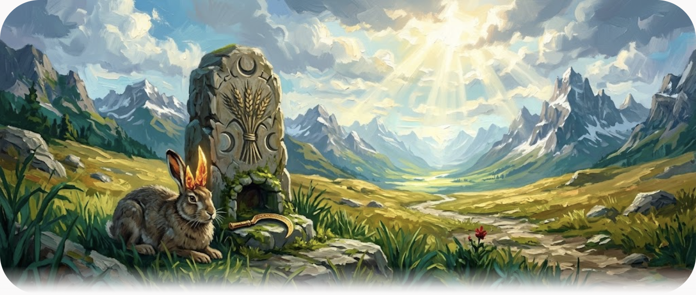

**Giudizio**: Forse la migliore del set: lepre corna-cristallo ambra, waystone spiga+luna, falce dorata in nicchia, strada serpeggiante verso valle. VISTA aperta.

**Prompt**:
```
Using the attached reference image for STYLE, PALETTE and PAINTING TECHNIQUE only (not its content), paint a new fantasy scene.

SUBJECT — one complete composition containing exactly these three inhabitants: CREATURE: an amber-horned hare — a large alpine hare with translucent amber crystal horns catching the light — resting beside the stone. PLACE: a harvest waystone: a waist-high standing stone carved with sheaf and moon marks, roadside at the pass, offering-niche at its foot. OBJECT: a gilded sickle — a votive golden sickle with engraved blade, laid as an offering in the waystone niche.

COMPOSITION — VISTA composition: open frame — the waystone in the near-middle third slightly left, the hare beside it, the pilgrim road winding away through golden alpine pasture to a distant luminous valley and peaks, broad sky occupying the upper half, foreground grass framing bottom edge. Read as a deliberate cinematic shot with clear foreground/midground/background and focal hierarchy; the creature gives scale, the object reads as the signature detail.

STYLE: RUDE BEAUTY key — weathered alpine wilderness, tactile rude matter, moss-thick bark and alpine stone; painted in heavy oil impasto, Jaime Jones broad palette-knife strokes on stone and bark, Jeff Easley weight. PALETTE: veronese-green foliage dominant, ultramarine depth, amber light accents, ONE crimson pigment accent, deep teal-emerald shadows — never grey, never brown mud. LIGHT: Solar Triumph white-gold sun breaking through in shafts; luminous, high-chroma, never murk.

KILL LIST: no text, no signatures, no watermarks, no logos, no UI, no modern objects, no grey or brown shadow mud, no murk, no flat digital airbrush look, no symmetrical centered composition, no duplicated subjects, no extra creatures beyond the one specified.

Wide 21:9 cinematic format, one painted canvas.
```

### impero-solare-sun-forge — TABLEAUX — PASS

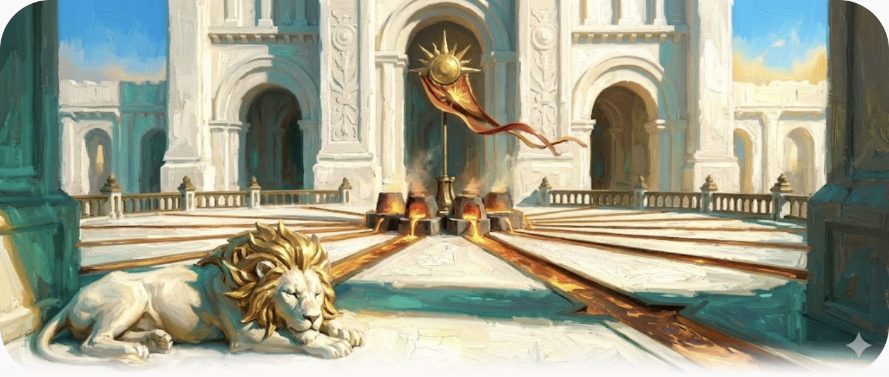

**Giudizio**: Leone criniera-raggi solari alla soglia, canali fusi a raggiera, stendardo-sole al cuore, fornaci. TABLEAUX da spec.

**Prompt**:
```
Using the attached reference image for STYLE, PALETTE and PAINTING TECHNIQUE only (not its content), paint a new fantasy scene.

SUBJECT — one complete composition containing exactly these three inhabitants: CREATURE: a solar-maned lion — a massive white lion whose mane is sculpted like golden sun-rays — dozing at the forge threshold. PLACE: the Sun-Forge: an imperial open-air crucible-terrace where molten metal channels run in a sun-ray pattern across white marble, furnaces glowing at the center. OBJECT: the imperial sun-standard — a great gold sunburst banner-standard planted at the forge's heart, cloth streaming.

COMPOSITION — TABLEAUX composition: a high-horizon stage — the forge-terrace fills the middle band like a proscenium, molten channels radiating toward the viewer, the lion guarding the near steps bottom-left, furnaces and standard centered on the far edge, imperial facade rising above, sky a narrow luminous band. Read as a deliberate cinematic shot with clear foreground/midground/background and focal hierarchy; the creature gives scale, the object reads as the signature detail.

STYLE: SOLAR EMPIRE key — monumental solar-baroque architecture: white stone, gold leaf, Sun-Bronze, imperial banners; painted in oil with architectural precision on stone, painterly impasto on sky and figures. PALETTE: white-gold dominant, azure sky, Sun-Bronze metal, cinabro red the single hot accent, teal-emerald shadows only — never grey, never brown. LIGHT: Solar Triumph — brilliant midday sun, hard clean shadows, luminous.

KILL LIST: no text, no signatures, no watermarks, no logos, no UI, no modern objects, no grey or brown shadow mud, no murk, no flat digital airbrush look, no symmetrical centered composition, no duplicated subjects, no extra creatures beyond the one specified.

Wide 21:9 cinematic format, one painted canvas.
```

### impero-solare-gold-aqueduct — CASCADE — PASS/WEAK

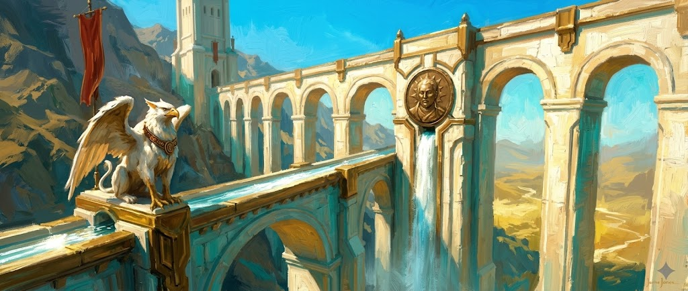

**Giudizio**: Grifone-envoy con collare su arco, medaglione sul pilone, acqua sotto. Lettura più 'parete' che diagonale discendente — CASCADE parziale.

**Prompt**:
```
Using the attached reference image for STYLE, PALETTE and PAINTING TECHNIQUE only (not its content), paint a new fantasy scene.

SUBJECT — one complete composition containing exactly these three inhabitants: CREATURE: a griffin-envoy — a white-and-gold imperial griffin wearing a bronze collar of office, perched on an aqueduct arch. PLACE: the gold aqueduct: a monumental imperial aqueduct descending the mountain in triple-tiered arches, water flashing in its open channel. OBJECT: a bronze medallion-portrait of the sun-emperor set into the aqueduct's central pier, water streaming beneath it.

COMPOSITION — CASCADE composition: the aqueduct descends diagonally from upper-left to lower-right in stepped arches, each tier stepping the eye down, the griffin perched on the nearest largest arch at the golden-section, mountain slopes and one imperial tower framing left, open luminous valley opening bottom-right. Read as a deliberate cinematic shot with clear foreground/midground/background and focal hierarchy; the creature gives scale, the object reads as the signature detail.

STYLE: SOLAR EMPIRE key — monumental solar-baroque architecture: white stone, gold leaf, Sun-Bronze, imperial banners; painted in oil with architectural precision on stone, painterly impasto on sky and figures. PALETTE: white-gold dominant, azure sky, Sun-Bronze metal, cinabro red the single hot accent, teal-emerald shadows only — never grey, never brown. LIGHT: Solar Triumph — brilliant midday sun, hard clean shadows, luminous.

KILL LIST: no text, no signatures, no watermarks, no logos, no UI, no modern objects, no grey or brown shadow mud, no murk, no flat digital airbrush look, no symmetrical centered composition, no duplicated subjects, no extra creatures beyond the one specified.

Wide 21:9 cinematic format, one painted canvas.
```

### impero-solare-processional-stair — GRID — PASS

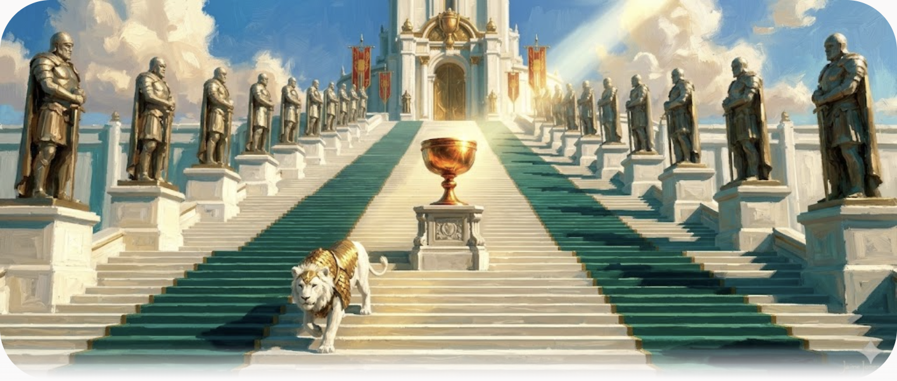

**Giudizio**: GRID esatto: statue-pilastri in reticolo prospettico, leonessa in barda al terzo inferiore, calice dorato che prende il raggio.

**Prompt**:
```
Using the attached reference image for STYLE, PALETTE and PAINTING TECHNIQUE only (not its content), paint a new fantasy scene.

SUBJECT — one complete composition containing exactly these three inhabitants: CREATURE: a parade lioness — a sleek white lioness caparisoned in Sun-Bronze scale-barding, mid-step down the stair. PLACE: the Processional Stair: a vast imperial ceremonial stair of a hundred white steps flanked by statue-pillars of past emperors, rising to a temple gate. OBJECT: a gilded chalice — an oversized ceremonial chalice on a pedestal at the stair's mid-landing, catching a beam of sun.

COMPOSITION — GRID composition: the stair's repeated balusters and statue-pillars form a strict perspective grid marching upward, the lioness breaking the rhythm at the lower third, the chalice pedestal at the mid-landing second focal, temple gate crowning the top, hard clean shadows raking the steps. Read as a deliberate cinematic shot with clear foreground/midground/background and focal hierarchy; the creature gives scale, the object reads as the signature detail.

STYLE: SOLAR EMPIRE key — monumental solar-baroque architecture: white stone, gold leaf, Sun-Bronze, imperial banners; painted in oil with architectural precision on stone, painterly impasto on sky and figures. PALETTE: white-gold dominant, azure sky, Sun-Bronze metal, cinabro red the single hot accent, teal-emerald shadows only — never grey, never brown. LIGHT: Solar Triumph — brilliant midday sun, hard clean shadows, luminous.

KILL LIST: no text, no signatures, no watermarks, no logos, no UI, no modern objects, no grey or brown shadow mud, no murk, no flat digital airbrush look, no symmetrical centered composition, no duplicated subjects, no extra creatures beyond the one specified.

Wide 21:9 cinematic format, one painted canvas.
```

### prismatic-frontier-crystal-aqueduct — ARCH — PASS

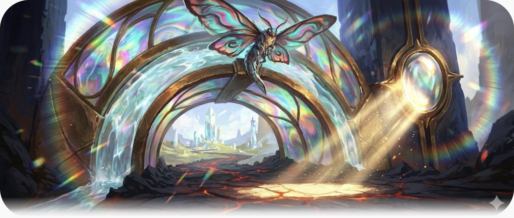

**Giudizio**: Drago-falena oil-slick su keystone, frame-within-frame, lente waymarker che focalizza il raggio sulla strada. Firma fortissima.

**Prompt**:
```
Using the attached reference image for STYLE, PALETTE and PAINTING TECHNIQUE only (not its content), paint a new fantasy scene.

SUBJECT — one complete composition containing exactly these three inhabitants: CREATURE: an oil-slick dragon-moth — a large moth-like dragon whose wings carry oil-slick iridescent patterns — perched on the arch keystone. PLACE: the crystal aqueduct: a frontier aqueduct of fused prismatic glass arches, water running inside the translucent channel, refracting spectral light. OBJECT: a waymarker lens — a great mounted glass lens set in the aqueduct's main pier, focusing a beam of sun onto the road.

COMPOSITION — ARCH composition: frame-within-frame — the largest arch spans the upper two-thirds and frames the frontier landscape beyond it, the dragon-moth on the keystone at top-center, the waymarker lens in the pier at right as second focal, the road threading under the arch toward distant crystal towers, spectral fringes edging every glass line. Read as a deliberate cinematic shot with clear foreground/midground/background and focal hierarchy; the creature gives scale, the object reads as the signature detail.

STYLE: PRISMATIC FRONTIER key — frontier of crystal, prismatic glass and dark bronze: glass structures refracting the light into spectral edges; painted in oil, glass rendered with sharp prismatic dabs and chromatic edge-fringes, matter in impasto. PALETTE: prismatic spectral accents (turquoise-magenta-amber refractions) over deep ultramarine and veronese base, bronze structure, ONE cinabro ember — shadows teal-emerald, never grey, never mud. LIGHT: Solar Triumph sun split by crystal into visible spectral shafts; luminous.

KILL LIST: no text, no signatures, no watermarks, no logos, no UI, no modern objects, no grey or brown shadow mud, no murk, no flat digital airbrush look, no symmetrical centered composition, no duplicated subjects, no extra creatures beyond the one specified.

Wide 21:9 cinematic format, one painted canvas.
```

### prismatic-frontier-observatory-dome — MONOLITH — PASS

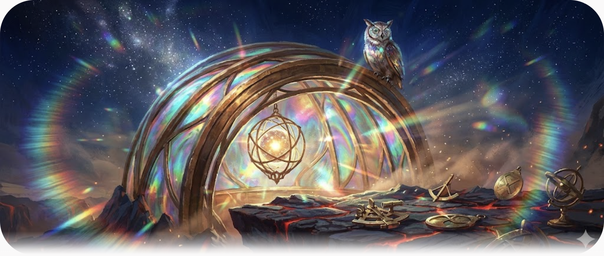

**Giudizio**: Cupola eroica, gufo occhi-di-vetro sul bordo, sfera stellare interna. Notte luminosa — borderline Solar Triumph ma coerente col mood frontier.

**Prompt**:
```
Using the attached reference image for STYLE, PALETTE and PAINTING TECHNIQUE only (not its content), paint a new fantasy scene.

SUBJECT — one complete composition containing exactly these three inhabitants: CREATURE: a glass-eyed owl — a large frontier owl whose eyes are literal faceted glass catching spectral light — on the dome's rim. PLACE: the Observatory Dome: a monumental half-buried prismatic glass dome rising from the frontier plateau, bronze ribs, its interior glowing. OBJECT: the captured-star sphere — a bronze-caged sphere of glowing starlight suspended visibly inside the dome.

COMPOSITION — MONOLITH composition: the dome rises as a single hero-mass center-left occupying two-thirds of the height, the owl small on its rim giving scale, the star-sphere glowing through the glass as inner focal, plateau ledge and scattered bronze instruments in foreground, night-blue frontier sky with luminous haze above. Read as a deliberate cinematic shot with clear foreground/midground/background and focal hierarchy; the creature gives scale, the object reads as the signature detail.

STYLE: PRISMATIC FRONTIER key — frontier of crystal, prismatic glass and dark bronze: glass structures refracting the light into spectral edges; painted in oil, glass rendered with sharp prismatic dabs and chromatic edge-fringes, matter in impasto. PALETTE: prismatic spectral accents (turquoise-magenta-amber refractions) over deep ultramarine and veronese base, bronze structure, ONE cinabro ember — shadows teal-emerald, never grey, never mud. LIGHT: Solar Triumph sun split by crystal into visible spectral shafts; luminous.

KILL LIST: no text, no signatures, no watermarks, no logos, no UI, no modern objects, no grey or brown shadow mud, no murk, no flat digital airbrush look, no symmetrical centered composition, no duplicated subjects, no extra creatures beyond the one specified.

Wide 21:9 cinematic format, one painted canvas.
```

### prismatic-frontier-beacon-tower — ISLAND — PASS

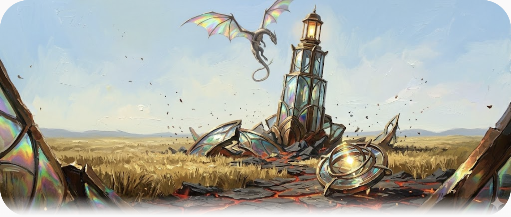

**Giudizio**: Drago membrane prismatiche avvolto alla torre, bussola-sole accesa, steppa+vuoto attorno. ISLAND pulita, ali spettacolari.

**Prompt**:
```
Using the attached reference image for STYLE, PALETTE and PAINTING TECHNIQUE only (not its content), paint a new fantasy scene.

SUBJECT — one complete composition containing exactly these three inhabitants: CREATURE: a prismatic-membrane dragon — a slender frontier dragon with translucent membrane wings splitting light into spectra — coiled around the tower's upper third. PLACE: the Beacon Tower: a lone prismatic glass-and-bronze beacon tower standing isolated in the open steppe, its lantern room burning. OBJECT: the captured-sun compass — a bronze compass device holding a floating point of condensed sunlight, mounted in the lantern room.

COMPOSITION — ISLAND composition: the tower stands alone in horizontal mid-frame like an island in the sea of grass, vast sky above and vast steppe below both empty, the dragon coiled around the upper third, the compass-light glowing at its top, a single dirt track leading to its base giving scale. Read as a deliberate cinematic shot with clear foreground/midground/background and focal hierarchy; the creature gives scale, the object reads as the signature detail.

STYLE: PRISMATIC FRONTIER key — frontier of crystal, prismatic glass and dark bronze: glass structures refracting the light into spectral edges; painted in oil, glass rendered with sharp prismatic dabs and chromatic edge-fringes, matter in impasto. PALETTE: prismatic spectral accents (turquoise-magenta-amber refractions) over deep ultramarine and veronese base, bronze structure, ONE cinabro ember — shadows teal-emerald, never grey, never mud. LIGHT: Solar Triumph sun split by crystal into visible spectral shafts; luminous.

KILL LIST: no text, no signatures, no watermarks, no logos, no UI, no modern objects, no grey or brown shadow mud, no murk, no flat digital airbrush look, no symmetrical centered composition, no duplicated subjects, no extra creatures beyond the one specified.

Wide 21:9 cinematic format, one painted canvas.
```

### dark-wasteland-siege-skeleton — VOID — PASS (v2, no-ref)

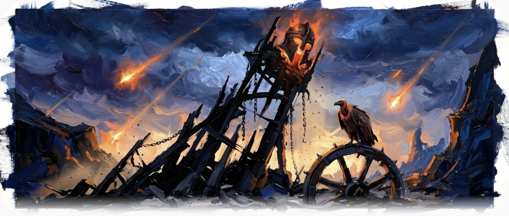

**Giudizio**: v1 FAIL: firma 'JONES' copiata dal ref. v2 generata senza ref (attach timeout) — elmo ember gigante in cima al relitto, avvoltoio sulla ruota. In-mood, più violetto-blu.

**Prompt**:
```
Using the attached reference image for STYLE, PALETTE and PAINTING TECHNIQUE only (not its content), paint a new fantasy scene.

SUBJECT — one complete composition containing exactly these three inhabitants: CREATURE: a carrion-herald vulture — a huge vulture with cinnabar-stained neck-feathers and an iron leg-band — perched on the broken wheel. PLACE: the siege-skeleton: the broken skeleton of a colossal war-tower, its split beams and hanging chains jutting from the ash like ribs. OBJECT: the ember-core helm — a great war-helm still glowing inside with ember light, fused into the wreck's summit.

COMPOSITION — VOID composition: the wreck's black jagged silhouette juts against an immense luminous storm-sky that fills the upper two-thirds, ground a thin ash band at bottom, the vulture small on the broken wheel at the golden-section, the ember-helm glowing cinnabar as the single hot focal in all that dark. Read as a deliberate cinematic shot with clear foreground/midground/background and focal hierarchy; the creature gives scale, the object reads as the signature detail.

STYLE: DARK WASTELAND key — obsidian and cinnabar wasteland: black glassy rock, ember cracks, ruined war-banners; painted in heavy oil impasto, matter weight over polish. PALETTE: obsidian-black and cinnabar-ember dominant, deep crimson accents, cold ultramarine sky rim — shadows stay saturated violet-umber and ember, NEVER grey, NEVER brown mud, never murk that swallows the form. LIGHT: a single blazing ember/cinnabar light source under a storm-luminous sky; high-chroma dark, luminous darkness — the blacks must glow.

KILL LIST: no text, no signatures, NO artist signature or painted name/initials mark anywhere in the image including all corners and edges, no "Jones" text, no watermarks, no logos, no UI, no modern objects, no grey or brown shadow mud, no murk, no flat digital airbrush look, no symmetrical centered composition, no duplicated subjects, no extra creatures beyond the one specified.

Wide 21:9 cinematic format, one painted canvas.
```

### dark-wasteland-obsidian-fortress — MONOLITH — PASS (v2, no-ref)

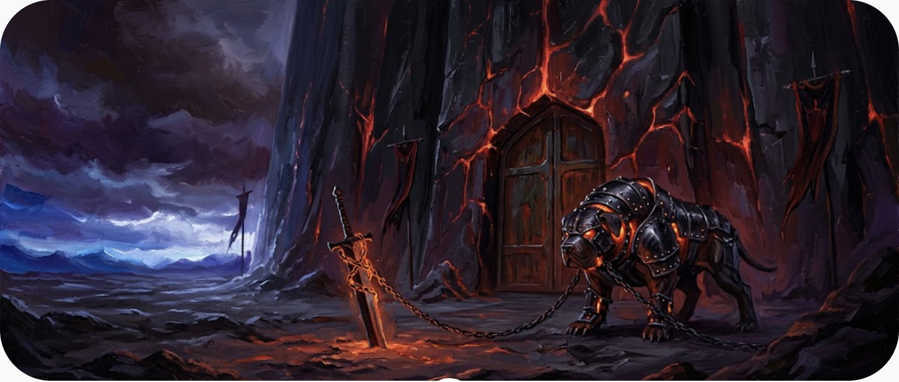

**Giudizio**: v1 FAIL: firma 'JONES'. v2 senza ref — lastra venata ember, mastino piastre+giunti ember al cancello, lama piantata in fg. Migliore della v1.

**Prompt**:
```
Using the attached reference image for STYLE, PALETTE and PAINTING TECHNIQUE only (not its content), paint a new fantasy scene.

SUBJECT — one complete composition containing exactly these three inhabitants: CREATURE: a brace-plated mastiff — a massive black war-mastiff in riveted obsidian plate-barding with ember-glow at the joints — chained at the gate. PLACE: the Obsidian Fortress: a monolithic black-glass fortress slab rising sheer from the plain, cinnabar ember-cracks veining its face, a single great gate. OBJECT: the ember-bound blade — a huge sword of dark metal bound in glowing ember-chains, planted point-down before the gate as a war-trophy.

COMPOSITION — MONOLITH composition: the fortress slab dominates the frame as a single black mass filling the right two-thirds edge-to-top, the mastiff small at the gate bottom-center-right, the ember-blade planted in the foreground ash lower-left as second focal, ember-cracks threading the slab, ash plain and storm-lit horizon strip on the left. Read as a deliberate cinematic shot with clear foreground/midground/background and focal hierarchy; the creature gives scale, the object reads as the signature detail.

STYLE: DARK WASTELAND key — obsidian and cinnabar wasteland: black glassy rock, ember cracks, ruined war-banners; painted in heavy oil impasto, matter weight over polish. PALETTE: obsidian-black and cinnabar-ember dominant, deep crimson accents, cold ultramarine sky rim — shadows stay saturated violet-umber and ember, NEVER grey, NEVER brown mud, never murk that swallows the form. LIGHT: a single blazing ember/cinnabar light source under a storm-luminous sky; high-chroma dark, luminous darkness — the blacks must glow.

KILL LIST: no text, no signatures, NO artist signature or painted name/initials mark anywhere in the image including all corners and edges, no "Jones" text, no watermarks, no logos, no UI, no modern objects, no grey or brown shadow mud, no murk, no flat digital airbrush look, no symmetrical centered composition, no duplicated subjects, no extra creatures beyond the one specified.

Wide 21:9 cinematic format, one painted canvas.
```

### dark-wasteland-banner-field — GRID — PASS (v2, ref pulita)

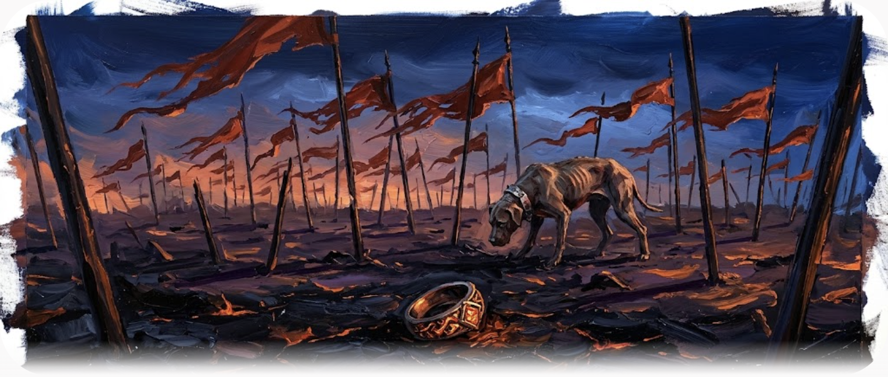

**Giudizio**: v1 FAIL: firma 'JONES'. v2 con ref croppata (banda firma rimossa) — sigillo-anello ember in fg, mastino sopravvissuto, reticolo pali a 3 ranghi. Nessuna firma.

**Prompt**:
```
Using the attached reference image for STYLE, PALETTE and PAINTING TECHNIQUE only (not its content), paint a new fantasy scene.

SUBJECT — one complete composition containing exactly these three inhabitants: CREATURE: a survivor mastiff — a gaunt war-mastiff with a cracked plate collar, sniffing among the banner-poles. PLACE: the Banner Field: a battlefield forest of broken banner-poles and torn cinnabar war-standards planted in the black ash. OBJECT: the signet-ring — a fallen commander's heavy seal-ring lying in the foreground ash, its ember-inlay still catching light.

COMPOSITION — GRID composition: the broken banner-poles form a ragged receding grid across the middle ground in three depth-ranks, torn standards streaming in one wind direction, the mastiff moving between the poles at mid-depth, the signet-ring in the near foreground at the golden-section, low storm-light raking across the ash. Read as a deliberate cinematic shot with clear foreground/midground/background and focal hierarchy; the creature gives scale, the object reads as the signature detail.

STYLE: DARK WASTELAND key — obsidian and cinnabar wasteland: black glassy rock, ember cracks, ruined war-banners; painted in heavy oil impasto, matter weight over polish. PALETTE: obsidian-black and cinnabar-ember dominant, deep crimson accents, cold ultramarine sky rim — shadows stay saturated violet-umber and ember, NEVER grey, NEVER brown mud, never murk that swallows the form. LIGHT: a single blazing ember/cinnabar light source under a storm-luminous sky; high-chroma dark, luminous darkness — the blacks must glow.

KILL LIST: no text, no signatures, NO artist signature or painted name/initials mark anywhere in the image including all corners and edges, no "Jones" text, no watermarks, no logos, no UI, no modern objects, no grey or brown shadow mud, no murk, no flat digital airbrush look, no symmetrical centered composition, no duplicated subjects, no extra creatures beyond the one specified.

Wide 21:9 cinematic format, one painted canvas.
```

## Coerenza di batch

- **Archetipi**: 12 assegnazioni, nessuna ripetizione adiacente; unico doppione MONOLITH (observatory-dome + obsidian-fortress) in mood diversi — accettabile.
- **Pattern compositivo ricorrente**: creatura a sinistra + oggetto firma a destra in 4/12 (shepherd, aqueducts). Da variare nei prossimi round.
- **Corna arrotondate / vignettatura soft-card**: presente in tutte — default di rendering Gemini, da dichiarare o tagliare in post se si integra in moodboard.
- **Palette per mood**: rude-beauty veronese+ambrato ✓, impero bianco-oro+cinabro ✓, frontier prismatico su ultramarine ✓, wasteland obsidian+ember (v2 più violetto del ref ma coerente).

## Lezioni per il form v2

1. Nuovo campo/check `REF-CLEAN`: le reference di stile vanno ispezionate per firme/watermark prima dell'attach — la kill-list non copre contenuto copiato dal ref.
2. Il blocco `COMPOSITION` in termini pittorici funziona: 10/12 archetipi leggibili al primo colpo.
3. La triade creatura+luogo+reliquia è rispettata 12/12 — enumerazione esplicita nel SUBJECT efficace.
4. Kill-list rinforzata su firme/corner-marks da promuovere a standard (il nome autore nello STYLE può indurre firme — Jones nominato solo in rude-beauty, ma la firma è apparsa via ref).
## Round v2 — registro battezzato (2026-10-25)

**Verdetto Director su v1: tutti bocciati** — tono, colori, pennellate, cielo, illuminazione, composizione cromatica sbagliati.

**Diagnosi**: fallimento sistematico 12/12 → non nei soggetti né nelle composizioni ma nel **blocco STYLE/LIGHTING condiviso**. Confronto con i prompt battezzati della bibbia:

| Bibbia (approvato) | v1 (bocciato) |
|---|---|
| light "slams", "blinding", "searing highlights" | "sun breaking through in shafts" → golden-hour |
| cielo "vibrant azure" / "vibrant indigo" | "luminous sky" → gradiente soft |
| ombre "glows in saturated teal", "cobalt vs burning orange" | "teal-emerald shadows" come vincolo negativo |
| "violent brushstrokes, visible layers, no digital smoothing" | "broad palette-knife strokes" → painterly liscio |
| "every plane vibrates", "no flat colors" | (mancava) |
| gate: suolo "volcanic rock veined with glowing red" | "deep ultramarine base" → terreno freddo |

**Fix a campo singolo**: riscritto solo il blocco STYLE/LIGHTING con il registro battezzato (soggetti+composizioni congelati) + kill-list estesa (no muted colors, no soft gradient skies, no rounded corners, full-bleed). Rerun completo: **12/12 in famiglia** — le strisce ref→generate quasi senza soluzione di continuità su tutti e 4 i mood.

**Lezione canonica per il form v2**: il blocco STYLE non ammette parafrasi — i termini-strumento sono `slams/blinding/searing`, `vibrant <pigment> sky`, `shadowed faces glow in saturated <pigment>`, `violent palette-knife impasto, visible layers, no digital smoothing`, `every plane vibrates`, `no muted tones, no haze washing color out`. Senza questo registro il generatore degrada a "tasteful muted concept-art" — il fallimento v1.

### Difetti residui v2
- Angoli arrotondati/vignetta "card" su frontier/impero (clausola full-bleed perde vs default Gemini; su wasteland il torn-edge del ref è stato copiato — meglio)
- Sparkle watermark piccolo bottom-right su alcune
- beacon-tower: forma torre libera (windmill-like) — soggetto ok, silhouette non-monolitica

### Immagini v1 bocciate
Archiviate in `images/v1-rejected/` per confronto didattico.

## Canon evolution (ruling Director 2026-10-25)

- **Le 4 chiavi esistono** (evoluzione della bibbia §1 che ne prevedeva 2): Rude Beauty (Wilderness), Impero Solare (Empire), Prismatic, Dark Wasteland.
- **Prismatic = rovine/invasioni da un altro multiverso** — le strutture prismatiche sono relitti alieni che NON appartengono al paesaggio: le scene devono leggerle come intrusioni, non architettura locale. Iridescenza solo su veli/membrane/lenti (legge già in nm-mutants family-dna).
- **Dark Wasteland**: NO meteore/sciami (fallimento ricorrente del generatore); impasto violento obbligatorio — troppa perfezione è FAIL; oscurità luminosa cobalto-vs-arancio.
- **Prismatic beams**: non in tutte le immagini — diventa prevedibile/noioso. Al massimo UN beam motivato (la lente waymarker); altrove iridescenza confinata ai materiali.
- **Prompt structure v3**: blocco `WORLD (why this exists)` prima di SUBJECT — il perché semantico del pilastro guida soggetto e composizione; creature dichiarate con la grammatica della family (mythic beast / imperial beast / intrusion-touched / survivor).

## Critica multi-AI sulla struttura prompt (run `mood-prompt-v3-critique`)

4/5 provider verificati via canary `QUILL-EMBER-9` (gemini, deepseek, chatgpt, grok; claude = sessione mai formata). Testi integrali in `critiques/`.

### Convergenze (tutte e 4)
- **WORLD era prosa motivazionale** → diventa KEY con campi visibili: pillar signature / light-event / medium / scale anchor
- **Triade = inventario, non narrativa** → role clause per elemento: creature embodies, place witnesses, relic leaks (da un'altra chiave = tiene le 4 chiavi nello stesso mondo)
- **Composizione deve essere per-chiave**: wilderness→VISTA/CASCADE eye-level · empire→MONOLITH/ARCH/GRID low-angle · prismatic→ISLAND/TABLEAUX tilt+wreckage-breaks-frame · wasteland→VOID/TABLEAUX rasoterra, horizon alto
- **Kill list diluita** → cap 5 igiene strutturale; kill estetici riscritti come positivi ("NO meteors" → "orange breaks inside the cloud mass"); 1 NOT-line per chiave
- Nuovi campi: **light-event** (verbo+geometria), **medium** (aria per chiave), **scale anchor**, **MOOD_PROOF** (test accettazione: senza nome-chiave, quale relazione visibile identifica il mood?)

→ applicato in `prompts-v4` (template convergente) + batch v4.

## Round v4 — template convergente multi-AI (2026-10-25)

Prompt riscritti nel template convergente (KEY semantics + role clauses + per-key composition + hygiene cap). Strisce ref→generate in `/tmp/mood-batch/compare4_*.png`.

### Esito contro le critiche Director
- **Solar Triumph**: bianco realmente accecante, cielo dissolto in haze bianco-oro — critica "bianco scuro" risolta
- **Wasteland meteore**: zero — l'arancio brucia dentro la massa indaco; impasto violento; torn-edge copiato dal ref
- **Prismatic beams**: iridescenza confinata a membrane/lenti/vetro; i relitti leggono come intrusione aliena (torre storta nella steppa ordinaria)
- **Rude Beauty**: cielo ciano-turchese saturo come il ref

### Note per eye-check Director
- Angoli arrotondati/vignetta residui su alcune (default Gemini vs clausola full-bleed)
- Le v1/v2 rifiutate in `images/rounds-archive/`
- Le 12 v4 finali in `images/`, i 12 prompt in `prompts-v4/`

## Draws 2-3 per scena (protocollo multi-draw)

24 generazioni aggiuntive (12 × d2 + 12 × d3) — tutte uniche, tutte REF_ATTACHED.
In `images/draws/`; contact-sheet per mood in `sheets/sheet_<mood>.png`
(riga REF + 3 draw per scena). Strisce confronto ref→v4 in `sheets/compare4_*.png`.

### Lettura batch
- **Rude Beauty**: 9/9 consistenti — cielo azure, prato veronese, bestie mitiche
- **Dark Wasteland**: 9/9 cobalto-vs-arancio, ZERO meteore su tutti i draw
  (la NOT-line+positivo ha risolto il fallimento sistematico), impasto violento
- **Impero Solare**: bianco accecante reale su tutti i draw
- **Prismatic**: iridescenza confinata ai materiali; wreckage-come-intrusione leggibile

Selezione Director: per ogni scena scegliere il draw migliore (base/d2/d3)
dalle contact-sheet — i candidati sono pari in aderenza, la scelta è estetica.

## Sky/meadow fix (2026-10-25, Director critique v4)

**Critica**: cielo non abbastanza azure/turchese, prati non veronese-vivi, un'immagine sul marrone.
**Diagnosi A/B**: stesso prompt originale → Grok=foto (ignora "oil painting"), Gemini=dipinto in famiglia → registro battezzato è generator-specific.
**Fix meccanico**: il colore dominante va nel light-event come CAMPO PRIMARIO — "under a VIVID CYAN-TURQUOISE AZURE SKY — the sky is the dominant saturated color field; meadows blaze in VIVID VERONESE GREEN, not yellow-brown". Risultato: 3/3 wilderness con cielo ciano saturo + prato veronese.
**Lezione**: il campo colore dominante non va nella lista palette — va nel light-event come soggetto cromatico della scena. Aggiunto al form (palette-field-as-primary-color-field).

## Ruling Director — aqueduct baseline

La **v1** di crystal-aqueduct resta la base di partenza canonica: concept
arcate-vetrata slanciate con mondo alieno visibile nei pannelli. v5/v7 =
esplorazioni laterali (bronzo massiccio, ether channel) — utili come lezioni
ma NON nuove baseline. Iterazioni future = edit/regen ancorate alla v1.
