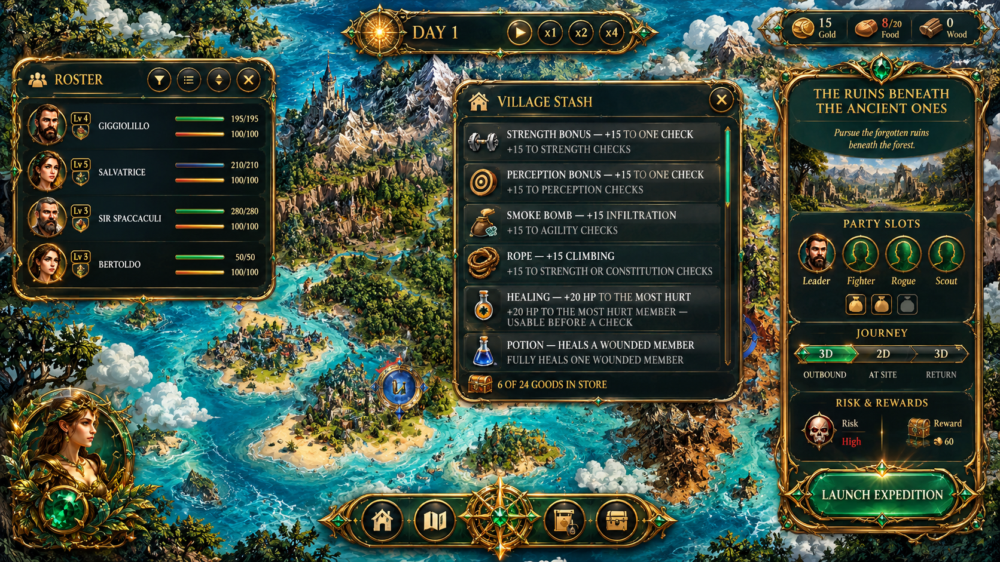

# PLAN-125 — Fix HUD /game dalla critica R-357 (esclusi i POI)

**Stato:** **proposta rev. 2, non battezzata.** Rev. 2 (2026-11-17) incorpora i ruling D-1..D-7 (sezione 3) e allarga lo scope: componente Eventi nuovo e nuovi mockup per tutti i componenti HUD. D-8 presa lo stesso giorno: tempo a sinistra, risorse al centro, Eventi a destra.

**Parent:** R-357 (`RICHIESTE.md`, verbatim Director 2026-11-17: *"sto facendo un restlying dei componenti di /game … ci sn tanti errori, imperfezioni, nn sn all'altezza dei mockup che avevo scelto, il componente in alto a sinistra ha il sole troppo piccolo … la direzione penso sia giusta, ma l'implementazione no. Esamina ogni piccolo dettaglio"*; poi *"scrivi un plan d fix d tutto, tranne i POI"*).

## Riferimenti visivi (registrati in `.mw/specs/expedition-ui/refs/`, vedi `REGISTERED.md`)

**Stato attuale (soggetto della critica R-357):** [screenshot-r357-hud-2026-11-17.png](../.mw/specs/expedition-ui/refs/screenshot-r357-hud-2026-11-17.png)

**Baseline di design (non ridiscussa):**

| Riferimento | Uso nel plan | File |
|---|---|---|
| Mockup ChatGPT | barra giorno, roster, stash, cassetto (fascia alta) — baseline Fasi 2–3 | [mockup-chatgpt.png](../.mw/specs/expedition-ui/refs/mockup-chatgpt.png) |
| Cassetto v2 — **golden reference** (R-353, «vabene la v2») | cassetto: Fasi 2e–2i, D-5 | [mockup-cassetto-v2.png](../.mw/specs/expedition-ui/refs/mockup-cassetto-v2.png) |
| Stash grid | griglia + dettaglio oggetto: Fasi 2k, 4, D-6 | [mockup-stash-grid.jpg](../.mw/specs/expedition-ui/refs/mockup-stash-grid.jpg) |

Registro completo: [REGISTERED.md](../.mw/specs/expedition-ui/refs/REGISTERED.md).

**Documentation Impact:** REQUIRED — `RICHIESTE.md` R-357 (stato e link al plan), contratti toccati (sezione 6), `context/DECISION_LOG.md` per ogni ruling Director che chiude una decisione della sezione 3.

---

## 0. Fatti verificati (2026-11-17)

Verificati sullo screenshot del Director (1474×745) e sui file, non su una cattura live di `/game`:

- **Sole / barra giorno** (alto a sinistra): il medaglione del sole è circa un terzo di quello del mockup. Il Director lo ha già segnalato. Componente: `src/ui/idleVillage/hudReal/HudRealTimeConnected.tsx` (39 righe), contratto `time-engine-strip.md`.
- **Risorse duplicate**: la barra al centro in alto (`GameTopChrome`, R-350/R-352) e un'altra striscia risorse nell'angolo in alto a destra del cassetto. Due ruling diversi la producono: R-323 (risorse nella testata del cassetto) e R-339/PLAN-119 T6 (top chrome snello). **Conflitto di ruling, non un bug semplice.**
- **Scrollbar native bianche** nel roster, verticale e orizzontale (la barra orizzontale in basso indica overflow orizzontale del contenuto). Componenti: `MatericRosterComponentV2.tsx` (15 righe) → `WanderlustRosterCardV2.tsx`; `DragTestContainerV2.tsx` è modificato nel worktree.
- **Rettangoli di mappa negli angoli** di roster e stash: gli ornamenti `corner-mockup-{tl,tr,bl,br}.webp` estratti dal mockup portano ancora lo sfondo (R-353, primitivo `PanelFrameOrnaments.tsx`, 85 righe).
- **Cassetto**: testi tagliati sul bordo sinistro interno («back» → «ack», «OUTBOUND» → «UTBOUND», frecce del viaggio tagliate). Componente `HudRealCassetto.tsx` (617 righe), contratto `hud-real-cassetto.md`.
- **Cassetto, zona descrizione**: circa metà vuota. Nel mockup-cassetto-v2 c'è un'illustrazione (rovine sotto l'arco) che nel build non compare.
- **Stash**: icone piatte gialle a linea (ascia, bersaglio, ancora, cuore) dentro una cornice dipinta. Il mockup ha oggetti dipinti. Componente `VillageStashPanel.tsx` (637 righe), icone `villageStashItemIcons.tsx` / `engravedIcons`, contratto `village-stash-item-icons.md`. Dettaglio oggetto: la stessa informazione compare tre volte (`+15 TO ONE CHECK`, `+15 to Strength checks`, `Covers: STR`) e il titolo va a capo. Pulsante `PACK` a pillola da web.
- **Ghiera slot**: draghi verdi. **Già ruled** (DECISION_LOG 2026-11-14, R-333 «ghiera DRAGHI = slot corretto»). Non si riapre.
- **Pulsante CONFIRM** (cassetto): sta dentro un riquadro scuro che non appartiene alla cornice. Nel mockup la placca è verde e fa parte della cornice.
- **Etichette slot** sotto le ghiere: circa 7 px grigi, illeggibili. «Expedition leader» va a capo.
- **Risk & Rewards**: «RISK —» vuoto; la riga di aiuto è circa 6 px e coperta da un ornamento; il teschio e il forziere hanno peso visivo molto diverso.
- **Controlli velocità** ×1 ×2 ×4: nessuno stato attivo visibile.
- **Nav in basso**: icone crema piatte invece di quelle dipinte del mockup; icone bloccate grigie poco leggibili.
- **Roster**: il nome «SIR SPACCAC…» è troncato anche con spazio libero. L'altezza del pannello taglia la terza riga a metà.

## 1. Obiettivo

Portare i cinque componenti (barra giorno, roster, stash, cassetto, nav) allo stesso livello dei mockup firmati, con **una sola scala di ornamento** e senza difetti di bug. Nessun componente nuovo. Nessuna riscrittura dei componenti che già funzionano.

## 2. Scope e non-scope

**Dentro:** barra giorno/sole, barra risorse (ripensata come componente centrale), **componente Eventi (nuovo, in alto a destra, coperto dal cassetto aperto)**, roster, stash (griglia, dettaglio), cassetto (testi, zona descrizione con illustrazione rigenerata, LAUNCH EXPEDITION, Risk & Rewards, etichette slot, niente più risorse), nav (stato bloccato, contrasto), velocità (stato attivo), scala ornamenti, tipografia e colori. **Nuovo mockup per ogni componente** prima dell'implementazione (ruling 2026-11-17).

**Dipendenza esterna:** il **programma icone** (D-6: tutte le icone da capo — stash, POI, nav, risorse) è trasversale e avrà un plan proprio. PLAN-125 ne consuma l'output; finché non arriva, le icone attuali restano.

**Fuori:**
- **POI** (tutto il Sigillo, le ghiere mappa, `MapQuestPoi`, `poiZanaraConfig`): escluso per richiesta.
- **Ruling già presi, non riaperti:** ghiera draghi (R-333); roster e stash sempre separati e flottanti (PLAN-124, R-347, R-353); stamina ambrata, non teal (R-353); smeraldo non schiarito (memoria 2026-11-04); niente viola in nessun ruolo e niente placca CTA smalto-teal (2026-10-20); blu bocciato come superficie dei pannelli (2026-10-28), ammesso solo sulla ghiera e sui POI; cassetto estratto con bordo destro a filo schermo (R-353, `drawer.edgeMode`).
- **Nessuna nuova superficie**, nessuna nuova feature di gioco.

## 3. Decisioni del Director

Ruling del 2026-11-17 (verbatim in `RICHIESTE.md` R-357, registro in `context/DECISION_LOG.md`):

| ID | Esito |
|---|---|
| **D-1** ✅ | Risorse **al centro**. Nel cassetto le risorse non servono più (supera la testata-risorse di R-323). In alto a destra va il **componente Eventi** (PLAN-117 F5): va creato, con mockup; il cassetto aperto lo copre e il design lo prevede. |
| **D-2** ⏸ | La clessidra significa «cibo a zero»; non deve esserci sempre. **Rinviata.** Nessun intervento in questo plan. |
| **D-3** ✅ | Il pulsante verde **LAUNCH EXPEDITION** del mockup va bene: eccezione al veto placca CTA del 2026-10-20, limitata all'azione primaria del cassetto. |
| **D-4** ✅ | Tipografia: si provano **3 stili** e si decide dal risultato. |
| **D-5** ✅ | Illustrazione del cassetto: **rigenerare**. |
| **D-6** ✅ | **Tutte le icone da capo** (stash, POI, nav, risorse, ogni altra): programma icone trasversale, plan proprio. |
| **D-7** ✅ | Il sole **esce** dalla barra; il tempo è un componente importante. |
| **D-8** ✅ | Banda alta: **tempo a sinistra, risorse al centro, Eventi a destra** (ruling 2026-11-17, «1 · Sì, così»). |

**Regola di copertura (da D-1):** il componente Eventi e il cassetto condividono la colonna destra. A riposo si vedono gli Eventi; quando si apre una quest il cassetto li copre interamente. Il componente Eventi non deve sporgere oltre il cassetto (stessa larghezza o più stretto, stesso bordo destro), così il cambio è pulito.

## 4. Piano di esecuzione

Ogni fase ha un artefatto verificabile prima della fase successiva.

**Fase 0 — Base e ordine di lavoro (nessun cambio di codice).**
- `git status` sui file del plan. Il worktree è condiviso con altre sessioni (T-13): molti file sono in modifica (`game-mappa2.tsx`, `VillageStashPanel.tsx`, `HudRealResources.tsx`, `PanelFrameOrnaments.tsx`, `WanderlustRosterCardV2.tsx`, `HeroLevelDecor.tsx`, `DragTestContainerV2.tsx`, `HudRealVictoryReward.tsx`, `cassettoColumn.ts`). Nessun commit che catturi lavoro altrui. Ogni task dichiara i suoi file.
- Cattura baseline **headless** di `/game` a 1440×900 e 1920×1080, con `--use-angle=metal`, porta propria (5197, come da memoria del harness), cwd verificato. Artefatto: `.mw/runs/<task>/baseline/`. Nessuna finestra in primo piano (regola 16).
- **Output:** baseline con 5 ritagli per componente, più lo screenshot di partenza dal Director.

**Fase 1 — Scala ornamenti e pulizia dei bordi (fondazione).**
- Una sola scala: angoli e bordo ornamento con la stessa misura in px su roster, stash, cassetto. Solo la parte centrale liscia si allarga.
- Rigenerare `corner-mockup-{tl,tr,bl,br}.webp` con alpha vera: lo sfondo di mappa deve essere trasparente fuori dall'ornamento.
- Collegare il token di scala a `PanelFrameOrnaments` e ai componenti dei pannelli.
- **Verifica:** `PanelFrameOrnaments` ha test di struttura (variante, dimensione fissa in px). Misura alpha degli angoli: zero pixel di mappa dentro il riquadro.
- **Claim visivo** (T-04): chiuso solo con occhio del Director su cattura zoomata. La metrica non basta.

**Fase 2 — Bug oggettivi (nessuna decisione di gusto).**
2a. **Scrollbar native** → scrollbar bronzea del design system (`data-hud-scroll`) su roster e stash. Scope sul root del pannello (T-03). Test: `closest('[data-hud-controls]')` o equivalente non nullo sul pannello e sul dropdown.
2b. **Overflow orizzontale del roster** → contenuto che non deve superare la larghezza del pannello. Test: `scrollWidth <= clientWidth` sul contenitore.
2c. **Altezza roster** → altezza calcolata su righe intere, o scroll visibile. Test: nessuna riga tagliata a metà a 1440×900 e 1920×1080.
2d. **Nome troncato** («SIR SPACCAC…») → niente ellissi quando c'è spazio libero; il testo prende la larghezza disponibile prima di troncare.
2e. **Cassetto, testi tagliati sul bordo sinistro** → padding interno uguale al content inset della striscia (T-23 regola 3). Test: ogni box di testo dentro il rettangolo interno del frame, misurato live.
2f. **Cassetto, zona descrizione vuota** → layout che usa lo spazio (con D-5 scelto). Senza D-5, solo testo centrato e padding, senza nuovi asset.
2g. **CONFIRM dentro riquadro scuro** → rimosso il riquadro; placca nella cornice (con D-3 scelto).
2h. **Risk & Rewards** → «RISK —» mostra il valore reale o un trattino coerente; peso uguale tra teschio e forziere; riga di aiuto sopra il minimo di leggibilità (token, proposta 11 px, da confermare).
2i. **Etichette slot** → minimo leggibile (stesso token di 2h); «Expedition leader» su una riga o con larghezza adatta.
2j. **Velocità ×1 ×2 ×4** → stato attivo visibile e `aria-pressed` (vale per il click reale). Test: l'attivo ha stile diverso e il click lo sposta.
2k. **Dettaglio oggetto** → una riga di effetto invece di tre ripetizioni (i18n di `VillageStashPanel`); titolo senza a capo forzato. Test: le chiavi i18n non ripetono lo stesso effetto (sul bundle it-IT).
2l. **Stato bloccato della nav** → contrasto minimo sul grigio, icona leggibile. Verifica occhio (T-04).
2m. **Risorse duplicate** → (D-1 ✅) la striscia risorse esce dal cassetto, dal layout e non solo visivamente; resta la barra centrale. Test: una sola occorrenza del nodo `resources` in DOM con il cassetto aperto.

**Fase 2bis — Nuovi mockup (ruling 2026-11-17: «tutti i componenti … rifatto un mock? direi di sì»).**
- Un mockup per componente, generato con lo stesso metodo di R-353 (ChatGPT web, allegati = mockup firmati come riferimento di stile): barra giorno con sole che esce, barra risorse come componente centrale, **componente Eventi**, roster, stash, cassetto (senza risorse, con illustrazione rigenerata), nav.
- **Componente Eventi:** contenuto da PLAN-117 F5 (obiettivi a medio/lungo termine, ordinati per scadenza, segno positivo/negativo leggibile senza solo colore, niente modali). Il mockup mostra sia lo stato a riposo sia il cassetto che lo copre.
- Ogni mockup passa dal visual fork gate (PLAN-047): card + ruling Director + baseline registrata in `.mw/specs/expedition-ui/refs/REGISTERED.md`.
- Disposizione fissata da D-8 ✅.

**Fase 3 — Barra giorno (richiesta esplicita del Director: «il sole troppo piccolo»).**
- Sole che **esce** dalla barra (D-7 ✅), misurato sul mockup nuovo della Fase 2bis (o sul mockup-chatgpt se il nuovo non cambia la barra). Il valore non è inventato: si misura il rapporto sole/barra sul mockup e lo si riporta come token.
- Il ritratto e la barra non cambiano; il sole è l'elemento che esce dalla barra.
- **Visual fork:** `visual-fork: skipped — motivo: correzione di misura su baseline firmata — puntatore: .mw/specs/expedition-ui/refs/mockup-chatgpt.png`.
- **Verifica:** occhio su cattura zoomata e misura del rapporto (riportata nel verification).

**Fase 4 — Componente Eventi, illustrazione del cassetto, icone.**
- Componente Eventi costruito dal mockup approvato della Fase 2bis, nella colonna destra, con la regola di copertura della sezione 3.
- Illustrazione del cassetto **rigenerata** (D-5 ✅), metodo «frame vuoto rigenerato > patching raster» (DECISION_LOG 2026-11-16).
- Icone: si montano quelle del **programma icone** (D-6 ✅) quando arrivano; questo plan non le disegna.

**Fase 5 — Tipografia, colori, griglia (D-4 ✅: 3 prove).**
- Tre proposte di stile tipografico applicate agli stessi componenti, affiancate; il Director sceglie dal risultato.
- Token unici dopo la scelta; avorio al posto del bianco puro.
- Margini uguali tra barra, roster, stash e cassetto (un unico valore di gutter).
- **Visual fork:** obbligatoria (due famiglie di tipografia = due rappresentazioni).

**Fase 6 — Verifica finale.**
- Witness headless su `/game` a 1440×900 e 1920×1080: ogni componente con cattura e misura.
- Occhio del Director su tre catture zoomate (roster, stash, cassetto) e sulla barra giorno.
- `closure:lint` e i gate globali: lo stato noto è BLOCKED per drift parallelo (R-322, R-350). Dichiarato, non nascosto.

## 5. Contratto di chiusura (obbligazioni verificabili)

| ID | Obbligazione | Tipo | Bloccante |
|---|---|---|---|
| OB-1 | Scala ornamenti uniforme: alpha dell'ornamento, zero pixel mappa nei riquadri (Fase 1) | `state` + test | sì |
| OB-2 | Scrollbar bronzea su roster/stash, nessuna scrollbar nativa (2a) | `state` + test struttura | sì |
| OB-3 | Nessun overflow orizzontale del roster; nessuna riga tagliata a metà (2b, 2c) | `state` (misura `scrollWidth`) | sì |
| OB-4 | Testi del cassetto dentro il frame, misurati live (2e) | `state` (bbox) | sì |
| OB-5 | Stato attivo della velocità + `aria-pressed` (2j) | `state` + test | sì |
| OB-6 | Una sola occorrenza di `resources` nel DOM (2m, dopo D-1) | `state` + test | sì (dopo D-1) |
| OB-7 | Sole ingrandito secondo il rapporto misurato sul mockup (Fase 3) | `human-eye` + misura | sì |
| OB-8 | Componente Eventi montato dal mockup approvato; con il cassetto aperto nessun pixel degli Eventi visibile (Fase 4, regola di copertura) | `state` (bbox) + `human-eye` + `visual-fork` | sì |
| OB-8b | Ogni componente ha un mockup approvato e registrato in `REGISTERED.md` prima della sua implementazione (Fase 2bis) | `visual-fork` | sì |
| OB-9 | Occhio del Director sui tre componenti zoomati e sulla barra giorno (Fase 6) | `human-eye` | sì |

**Regression test (R-247):** ogni bug di Fase 2 ha un test permanente che fallirebbe senza la correzione (OB-2, OB-3, OB-5, OB-6, OB-4 con bbox).

## 6. Contratti e file toccati (da verificare prima di ogni task)

- `src/ui/idleVillage/hudReal/HudRealTimeConnected.tsx`, contratto `time-engine-strip.md` — sole (Fase 3)
- `src/ui/idleVillage/hudReal/HudRealResources.tsx`, `resource-readout.md` — D-1
- `src/ui/idleVillage/hudReal/HudRealCassetto.tsx`, contratto `hud-real-cassetto.md` (INV-1..5) — Fasi 2e, 2f, 2g, 2h, 2i
- `src/ui/idleVillage/components/gameFrame/VillageStashPanel.tsx`, contratto `village-stash-panel.md` — Fasi 2a, 2k, 4
- `src/ui/idleVillage/components/gameFrame/villageStashItemIcons.tsx`, contratto `village-stash-item-icons.md` — Fase 4
- `src/ui/idleVillage/rosterV2/MatericRosterComponentV2.tsx`, `WanderlustRosterCardV2.tsx` (contratto `wanderlust-roster-card-v2.md`, INV-1), `materic-roster-component-v2.md` — Fasi 2a, 2b, 2c, 2d
- `src/ui/idleVillage/skins/primitives/PanelFrameOrnaments.tsx` — Fase 1
- `src/ui/idleVillage/hudReal/HudRealNav.tsx` — Fase 2l
- `game-top-chrome` (INV-2/4/6, amendati R-350/R-352) — qualsiasi modifica alla barra centrale

Per ogni INV toccato: `sync:bug` + `redfirst` o `redfirst:retire` con `R-NNN` (PLAN-054, Living contracts). Nessun fix su superficie contrattata senza la regola che lo copre.

## 7. Trappole che il piano eredita

- **T-03** — scope CSS sul root del componente, incluse le superfici che si aprono (dropdown, popover, portal). Vale per la scrollbar (2a) e per i menu.
- **T-04** — ogni claim percettivo (sole più grande, testi non tagliati, icone più leggibili) si chiude con occhio del Director su una cattura reale. La metrica è supporto.
- **T-05** — «migliora X» non è «riscrivi X». Ogni fase tocca solo i file dichiarati. Stop se una fase richiede una riscrittura.
- **T-07** — derivati visuali (stato attivo della velocità, countdown della barra giorno) vengono dal proprietario del dato, non da una simulazione parallela.
- **T-13** — worktree condiviso: nessun commit di lavoro altrui, nessun failure di probe trattato come bug nostro prima di averlo riprovato.
- **T-14 / T-15** — i driver Playwright (selettori, testid, tsx) si aggiornano insieme ai cambi di layout.
- **T-23** — striscia collassata e content inset: misura su bbox live, non a occhio.
- **T-21** — controlli nativi dentro un pill `data-hud-controls`: la hit area è il rect dell'elemento (velocità, pulsanti del roster).
- **Memoria HUD (non trappole, ruling):** niente CTA a placca salvo D-3; niente viola; blu solo su ghiera e POI; roster e stash separati; stamina ambrata; smeraldo non schiarito.

## 8. Rischi e cosa non si verifica

- **Il rischio maggiore è la mia lettura dell'immagine.** Lo screenshot è a 1474 px. Ogni misura (rapporto del sole, altezze, overflow) va rifatta su cattura live prima di chiudere la fase.
- **Asset:** le icone dipinte e l'illustrazione dipendono dal Director (D-5, D-6). Senza di loro la Fase 4 resta aperta, e lo dichiariamo come tale.
- **Closure globale:** `closure:lint` può restare BLOCKED per drift parallelo, come già accade per R-322 e R-350. Il bundle del singolo task resta valido se i suoi OB sono PASS.
- **Non verificato da questo piano:** nessuna cattura live di `/game` è stata fatta in questa sessione. Il banco di prova dei POI è un montaggio HTML, non il motore Pixi, e non è usato come prova dei componenti HUD.

## 9. Ordine proposto (rev. 2)

Fase 0 → Fase 1 → Fase 2 (bug) in parallelo alla Fase 2bis (mockup) → Fase 3 (sole) → Fase 4 (Eventi, illustrazione, icone quando pronte) → Fase 5 (3 prove tipografiche) → Fase 6.

I bug della Fase 2 non dipendono dai mockup e possono partire subito dopo il battesimo. La Fase 2bis può partire subito (D-8 ✅).
