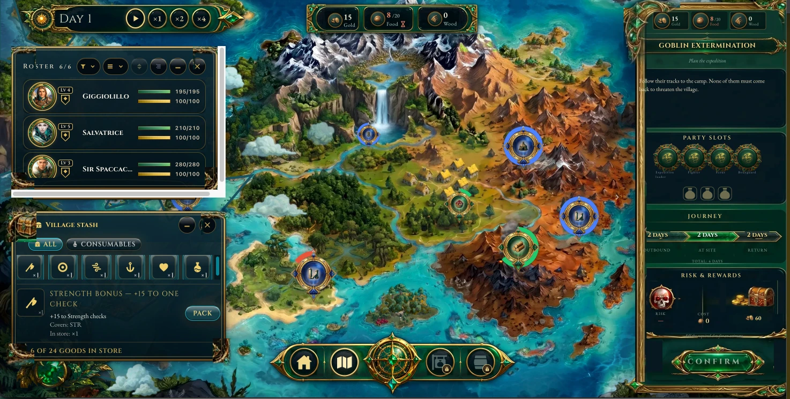
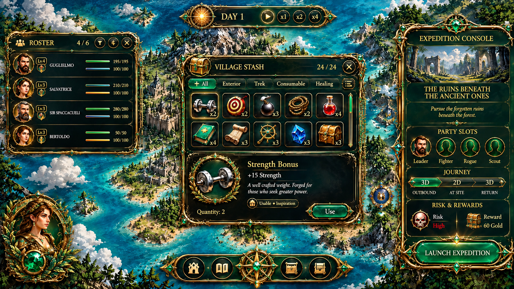
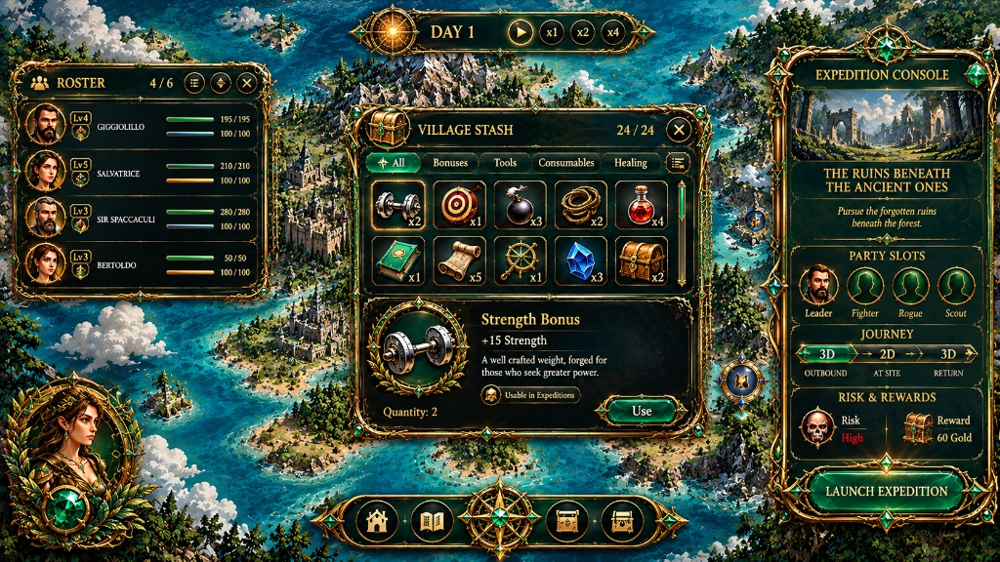

# PLAN-125 — Restyling HUD /game (critica R-357): cassetto, roster, stash, victory/reward, eventi, dettagli, POI

**Stato:** **BATTEZZATO 2026-11-17 (rev. 3, ruling Director «battezza ed handoff»)** — `npm run plan:stamp -- open PLAN-125` eseguito (`context/plan-timing.jsonl`, 2026-11-17T20:23Z; la rigenerazione forensics è stata saltata dallo script per un percorso `../mind-weaver` fuori repo, non bloccante). Handoff in `SESSION_HANDOFF.md` (voce 2026-11-17). Rev. 3 registra cosa è già fatto sul **cassetto** (approvato per palette, montato su `/game`), fissa il **metodo** che ha funzionato e allarga lo scope: portare le altre superfici (roster, stash, victory/reward) allo stesso standard su `/game`, e proseguire i mockup di ciò che ancora non esiste (Detail, Eventi, POI, bande di scorrimento, …). Rev. 2 aveva incorporato i ruling D-1..D-8.

**Nome del plan: PLAN-125.** (Il file resta `plans/PLAN-125-hud-fix-r357.md` per non rompere i link; il titolo ora dice «Restyling».)

**Parent:** R-357 (`RICHIESTE.md`, verbatim Director 2026-11-17: *"sto facendo un restlying dei componenti di /game … ci sn tanti errori, imperfezioni, nn sn all'altezza dei mockup che avevo scelto, il componente in alto a sinistra ha il sole troppo piccolo … la direzione penso sia giusta, ma l'implementazione no. Esamina ogni piccolo dettaglio"*; poi *"scrivi un plan d fix d tutto, tranne i POI"*).

## Riferimenti visivi (registrati in `.mw/specs/expedition-ui/refs/`, vedi `REGISTERED.md`)

**Stato attuale (soggetto della critica R-357):** [screenshot-r357-hud-2026-11-17.png](../.mw/specs/expedition-ui/refs/screenshot-r357-hud-2026-11-17.png)

**Baseline di design (non ridiscussa):**

| Riferimento | Uso nel plan | File |
|---|---|---|
| Mockup ChatGPT | barra giorno, roster, stash, cassetto (fascia alta) — baseline Fasi 2–3 | [mockup-chatgpt.png](../.mw/specs/expedition-ui/refs/mockup-chatgpt.png) |
| Cassetto v2 — **golden reference** (R-353, «vabene la v2») | cassetto: Fasi 2e–2i, D-5 | [mockup-cassetto-v2.png](../.mw/specs/expedition-ui/refs/mockup-cassetto-v2.png) |
| Stash grid | griglia + dettaglio oggetto: Fasi 2k, 4, D-6 | [mockup-stash-grid.jpg](../.mw/specs/expedition-ui/refs/mockup-stash-grid.jpg) |

Registro completo: [REGISTERED.md](../.mw/specs/expedition-ui/refs/REGISTERED.md).

**Documentation Impact:** REQUIRED — `RICHIESTE.md` R-357 (stato e link al plan), contratti toccati (sezione 6), `context/DECISION_LOG.md` per ogni ruling Director che chiude una decisione della sezione 3.

---

## 0. Fatti verificati (2026-11-17)

Verificati sullo screenshot del Director (1474×745) e sui file, non su una cattura live di `/game`:

- **Sole / barra giorno** (alto a sinistra): il medaglione del sole è circa un terzo di quello del mockup. Il Director lo ha già segnalato. Componente: `src/ui/idleVillage/hudReal/HudRealTimeConnected.tsx` (39 righe), contratto `time-engine-strip.md`.
- **Risorse duplicate**: la barra al centro in alto (`GameTopChrome`, R-350/R-352) e un'altra striscia risorse nell'angolo in alto a destra del cassetto. Due ruling diversi la producono: R-323 (risorse nella testata del cassetto) e R-339/PLAN-119 T6 (top chrome snello). **Conflitto di ruling, non un bug semplice.**
- **Scrollbar native bianche** nel roster, verticale e orizzontale (la barra orizzontale in basso indica overflow orizzontale del contenuto). Componenti: `MatericRosterComponentV2.tsx` (15 righe) → `WanderlustRosterCardV2.tsx`; `DragTestContainerV2.tsx` è modificato nel worktree.
- **Rettangoli di mappa negli angoli** di roster e stash: gli ornamenti `corner-mockup-{tl,tr,bl,br}.webp` estratti dal mockup portano ancora lo sfondo (R-353, primitivo `PanelFrameOrnaments.tsx`, 85 righe).
- **Cassetto**: testi tagliati sul bordo sinistro interno («back» → «ack», «OUTBOUND» → «UTBOUND», frecce del viaggio tagliate). Componente `HudRealCassetto.tsx` (617 righe), contratto `hud-real-cassetto.md`.
- **Cassetto, zona descrizione**: circa metà vuota. Nel mockup-cassetto-v2 c'è un'illustrazione (rovine sotto l'arco) che nel build non compare.
- **Stash**: icone piatte gialle a linea (ascia, bersaglio, ancora, cuore) dentro una cornice dipinta. Il mockup ha oggetti dipinti. Componente `VillageStashPanel.tsx` (637 righe), icone `villageStashItemIcons.tsx` / `engravedIcons`, contratto `village-stash-item-icons.md`. Dettaglio oggetto: la stessa informazione compare tre volte (`+15 TO ONE CHECK`, `+15 to Strength checks`, `Covers: STR`) e il titolo va a capo. Pulsante `PACK` a pillola da web.
- **Ghiera slot**: draghi verdi. **Già ruled** (DECISION_LOG 2026-11-14, R-333 «ghiera DRAGHI = slot corretto»). Non si riapre.
- **Pulsante CONFIRM** (cassetto): sta dentro un riquadro scuro che non appartiene alla cornice. Nel mockup la placca è verde e fa parte della cornice.
- **Etichette slot** sotto le ghiere: circa 7 px grigi, illeggibili. «Expedition leader» va a capo.
- **Risk & Rewards**: «RISK —» vuoto; la riga di aiuto è circa 6 px e coperta da un ornamento; il teschio e il forziere hanno peso visivo molto diverso.
- **Controlli velocità** ×1 ×2 ×4: nessuno stato attivo visibile.
- **Nav in basso**: icone crema piatte invece di quelle dipinte del mockup; icone bloccate grigie poco leggibili.
- **Roster**: il nome «SIR SPACCAC…» è troncato anche con spazio libero. L'altezza del pannello taglia la terza riga a metà.

## 0bis. Stato rev. 3 (2026-11-17) — cosa è fatto, cosa no

**Metodo che ha funzionato (da riusare su ogni superficie, in quest'ordine):**
1. **Golden**: il mockup approvato dal Director, registrato in `.mw/specs/expedition-ui/refs/REGISTERED.md` + riga in `context/DECISION_LOG.md`. Un elemento alla volta, mai l'HUD intera (ruling 2026-11-17).
2. **Ricostruzione in DOM** dal golden: testo, controlli e geometria vivi; solo le parti *dipinte* restano immagini, ritagliate da uno script (`scripts/build-cassetto3-assets.py`), mai l'arte unica «cotta» con zone assolute (quella strada ha prodotto tagli, stiramenti e residui sul vecchio cassetto).
3. **Palette dalla nav** (golden standard dei colori, ruling 2026-11-17): oro champagne 45°/49%/79%, verde (10,67,42); correzione con `scripts/lib_grade_gold.py`; misura live prima/dopo (non a occhio).
4. **Token**: colori e stati dei pulsanti in `skinCssVariables.ts` + `cassettoLayoutConfig` (AC8), mai letterali nel componente.
5. **Witness live su `/game`** a 1440×900 (headless, `--use-angle=metal`, porta 5197, clic sul POI), con **ingrandimenti** e un **audit di ogni nodo di testo** (clip, copertura via `elementFromPoint`, uscita dalla colonna): script in `.mw/runs/20261117-r357-cassetto-bugs/audit.mjs`. T-04: un claim visivo si chiude solo con ciò che l'occhio può vedere ingrandito; due volte in questa sessione ho dichiarato «fatto» senza guardare ingrandito (cornice nord, aloni) e il Director se n'è accorto.
6. **Test di regressione** per ogni correzione (`// INV:`), amend dichiarato dei test che fissavano il vecchio disegno.

**Cassetto — stato:**

| Voce | Stato |
|---|---|
| Golden `mockup-r357-cassetto-largo.png`, DOM, 512 px a 1440×900, destra a filo, senza barra risorse né «EXPEDITION CONSOLE» | ✅ montato su `/game` |
| Cornice nord piena, bordo sx, plancia CTA con finestra trasparente + smalto vivo (riposo/hover/press/focus/disabled su token) | ✅ |
| Palette allineata alla nav (cornice 42°/56%/71%; ghiere 41°/53%/64%), aloni di teschio/forziere tolti | ✅ approvata («approvo») |
| Slot: simboli di ruolo (preset `draghiGlifo`), drago archiviato (`ghiera-draghi.webp`, preset `draghi`) | ✅ |
| Titoli di blocco tolti; Supplies centrate + scroller; chiusura con Esc e × | ✅ (feedback 2026-11-17) |
| Animazione laterale 280 ms (`drawer.slideMs`), reduced-motion rispettato | ✅ non vista a velocità reale |
| `cost` | ❌ **non deve esistere**; idea salvata in `.mw/specs/expedition-ui/ideas.md#cost-preview` |
| **Numero di tasche per quest** (oggi `QUEST_STASH.bagSlots`=3 globale, max 8): campo per POI + lunghezza del ledger | ⏳ aperto, è una modifica ai dati |
| **Vignetta dalla quest** (oggi sempre le rovine) | ⏳ aperto |
| Detail (Party / Supplies / Risk & Rewards) come componente a sinistra del cassetto, non modale, uno alla volta (GX-0042) | ⏳ manca il mockup |
| Roster in modalità «assegna» e Stash in modalità «porta con te» dal clic su ghiera/tasca | ⏳ |
| × = scarta o tiene la scelta di eroi/oggetti? (chiudere ≠ piegare col chip) | ⏳ decisione Director |
| Clic sulla mappa per chiudere | ✗ sconsigliato (pan/zoom, POI): proposta registrata, non implementata |
| Più premi (oggetti, XP) oltre all'oro; titoli lunghi; it-IT («PARTI IN SPEDIZIONE»); ordine di Tab | ⏳ da verificare |
| Variante 1280, bottom sheet ≤1100 px (usa ancora la cella `cost` vuota segnaposto) | ⏳ mai catturate |
| Contratto `hud-real-cassetto` (INV-1..5 + nuove regole), `sync:bug`/`redfirst`, **commit** | ⏳ nessun commit fatto (worktree condiviso, T-13) |

**Superfici ancora da portare allo standard (tutte già montate su `/game`, `src/pages/game-mappa2.tsx`):**

| Superficie | Componente / contratto | Cosa manca |
|---|---|---|
| **Roster** | `MatericRosterComponentV2` → `WanderlustRosterCardV2`, toolbar in `DragTestContainerV2` | cornice battezzata (angoli ad acanto + gemma, intestazione incisa), toolbar identica a Stash/Ledger (icone: imbuto / barrette / frecce opposte / vista / − / ×), ghiere dei ritratti con artigli, livello «LV n» leggibile, **banda di scorrimento** per gli eroi nascosti, bug 2a–2d |
| **Stash** | `VillageStashPanel` (637 righe), `villageStashItemIcons`, contratto `village-stash-panel` | cornice battezzata, chip categoria ALL/CONSUMABLES + «N of M goods», scheda dettaglio **dentro** la cornice, icone dipinte (programma icone D-6), **banda di scorrimento**, modalità «porta con te» |
| **Victory / Reward** | `HudRealVictoryReward` (contratto `hudreal-victory-reward`), `questEpilogue`, `questSettlement` | **nessun mockup nuovo ancora**: va riportata alla palette-nav e alla cornice battezzata; verificare che segua il metodo (DOM + ritagli) e non arte cotta |

**Mockup ancora da fare** (un elemento alla volta, ognuno con golden registrato prima del codice):

| Mockup | Stato |
|---|---|
| **Detail** del cassetto (Party, Supplies, Risk & Rewards) | da fare — il primo da fare, sblocca clic e Roster/Stash «assegna» |
| **World Ledger / Eventi** (colonna destra, coperta dal cassetto): v4c (`mockup-r357-hud-aperta-v4c.png`) approvato per toolbar/filtri e risorse, bocciato per sole e cornici; mancano la versione chiusa corretta e l'**Event Detail** | in corso |
| **Sole** (rifatto da solo, medaglione con gemma, non il v4c) | da fare — serve dal Director cosa non va (forma/colori) |
| **Banda di scorrimento** (barra incisa, uguale su Roster/Stash/Ledger) | da fare |
| **POI** (Sigillo, 3 varianti A/B/C sul banco `/lab/poi-luogo`; Director ha detto che i POI attuali non gli piacciono) | rientra nel plan solo come **mockup**; l'implementazione resta fuori finché non c'è il golden |
| **Icone** (D-6, programma trasversale) | plan proprio, non scritto |
| **Tipografia** (D-4, 3 prove) | **implementata 2026-11-21 — ruling Director: A «inciso»** (Marcellus+Cardo). woff2 self-hosted in `public/fonts/`, `@font-face` in `index.css`, stack su `--skin-font-*`/`--wl-font-*` + rename dei literal in `src/ui/idleVillage/**` e `wanderlust-surface` (71 file, Cinzel/EB Garamond restano in fallback). Guida §4.3 aggiornata (Marcellus ha minuscolo vero → maiuscoletto via `text-transform`). Prove e specimen in `.mw/runs/20261120-d4-typography/` |

## 1. Obiettivo

Portare i cinque componenti (barra giorno, roster, stash, cassetto, nav) allo stesso livello dei mockup firmati, con **una sola scala di ornamento** e senza difetti di bug. Nessun componente nuovo. Nessuna riscrittura dei componenti che già funzionano.

## 2. Scope e non-scope

**Dentro:** barra giorno/sole, barra risorse (ripensata come componente centrale), **componente Eventi (nuovo, in alto a destra, coperto dal cassetto aperto)**, roster, stash (griglia, dettaglio), cassetto (testi, zona descrizione con illustrazione rigenerata, LAUNCH EXPEDITION, Risk & Rewards, etichette slot, niente più risorse), nav (stato bloccato, contrasto), velocità (stato attivo), scala ornamenti, tipografia e colori. **Nuovo mockup per ogni componente** prima dell'implementazione (ruling 2026-11-17).

**Dipendenza esterna:** il **programma icone** (D-6: tutte le icone da capo — stash, POI, nav, risorse) è trasversale e avrà un plan proprio. PLAN-125 ne consuma l'output; finché non arriva, le icone attuali restano.

**Fuori:**
- **POI — implementazione** (Sigillo, ghiere mappa, `MapQuestPoi`, `poiZanaraConfig`): fuori finché non c'è un golden. **Rev. 3: i mockup dei POI rientrano nel plan** (richiesta 2026-11-17 «continuare il lavoro sui mockup di quello che ancora non abbiamo (… i POI …)»).
- **Ruling già presi, non riaperti:** ghiera draghi (R-333); roster e stash sempre separati e flottanti (PLAN-124, R-347, R-353); stamina ambrata, non teal (R-353); smeraldo non schiarito (memoria 2026-11-04); niente viola in nessun ruolo e niente placca CTA smalto-teal (2026-10-20); blu bocciato come superficie dei pannelli (2026-10-28), ammesso solo sulla ghiera e sui POI; cassetto estratto con bordo destro a filo schermo (R-353, `drawer.edgeMode`).
- **Nessuna nuova superficie**, nessuna nuova feature di gioco.

## 3. Decisioni del Director

Ruling del 2026-11-17 (verbatim in `RICHIESTE.md` R-357, registro in `context/DECISION_LOG.md`):

| ID | Esito |
|---|---|
| **D-1** ✅ | Risorse **al centro**. Nel cassetto le risorse non servono più (supera la testata-risorse di R-323). In alto a destra va il **componente Eventi** (PLAN-117 F5): va creato, con mockup; il cassetto aperto lo copre e il design lo prevede. |
| **D-2** ⏸ | La clessidra significa «cibo a zero»; non deve esserci sempre. **Rinviata.** Nessun intervento in questo plan. |
| **D-3** ✅ | Il pulsante verde **LAUNCH EXPEDITION** del mockup va bene: eccezione al veto placca CTA del 2026-10-20, limitata all'azione primaria del cassetto. |
| **D-4** ✅ | Tipografia: si provano **3 stili** e si decide dal risultato. |
| **D-5** ✅ | Illustrazione del cassetto: **rigenerare**. |
| **D-6** ✅ | **Tutte le icone da capo** (stash, POI, nav, risorse, ogni altra): programma icone trasversale, plan proprio. |
| **D-7** ✅ | Il sole **esce** dalla barra; il tempo è un componente importante. |
| **D-8** ✅ | Banda alta: **tempo a sinistra, risorse al centro, Eventi a destra** (ruling 2026-11-17, «1 · Sì, così»). |

**Regola di copertura (da D-1):** il componente Eventi e il cassetto condividono la colonna destra. A riposo si vedono gli Eventi; quando si apre una quest il cassetto li copre interamente. Il componente Eventi non deve sporgere oltre il cassetto (stessa larghezza o più stretto, stesso bordo destro), così il cambio è pulito.

## 4. Piano di esecuzione

Ogni fase ha un artefatto verificabile prima della fase successiva.

**Fase 0 — Base e ordine di lavoro (nessun cambio di codice).**
- `git status` sui file del plan. Il worktree è condiviso con altre sessioni (T-13): molti file sono in modifica (`game-mappa2.tsx`, `VillageStashPanel.tsx`, `HudRealResources.tsx`, `PanelFrameOrnaments.tsx`, `WanderlustRosterCardV2.tsx`, `HeroLevelDecor.tsx`, `DragTestContainerV2.tsx`, `HudRealVictoryReward.tsx`, `cassettoColumn.ts`). Nessun commit che catturi lavoro altrui. Ogni task dichiara i suoi file.
- Cattura baseline **headless** di `/game` a 1440×900 e 1920×1080, con `--use-angle=metal`, porta propria (5197, come da memoria del harness), cwd verificato. Artefatto: `.mw/runs/<task>/baseline/`. Nessuna finestra in primo piano (regola 16).
- **Output:** baseline con 5 ritagli per componente, più lo screenshot di partenza dal Director.

**Fase 1 — Scala ornamenti e pulizia dei bordi (fondazione).**
- Una sola scala: angoli e bordo ornamento con la stessa misura in px su roster, stash, cassetto. Solo la parte centrale liscia si allarga.
- Rigenerare `corner-mockup-{tl,tr,bl,br}.webp` con alpha vera: lo sfondo di mappa deve essere trasparente fuori dall'ornamento.
- Collegare il token di scala a `PanelFrameOrnaments` e ai componenti dei pannelli.
- **Verifica:** `PanelFrameOrnaments` ha test di struttura (variante, dimensione fissa in px). Misura alpha degli angoli: zero pixel di mappa dentro il riquadro.
- **Claim visivo** (T-04): chiuso solo con occhio del Director su cattura zoomata. La metrica non basta.

**Fase 2 — Bug oggettivi (nessuna decisione di gusto).**
2a. **Scrollbar native** → scrollbar bronzea del design system (`data-hud-scroll`) su roster e stash. Scope sul root del pannello (T-03). Test: `closest('[data-hud-controls]')` o equivalente non nullo sul pannello e sul dropdown.
2b. **Overflow orizzontale del roster** → contenuto che non deve superare la larghezza del pannello. Test: `scrollWidth <= clientWidth` sul contenitore.
2c. **Altezza roster** → altezza calcolata su righe intere, o scroll visibile. Test: nessuna riga tagliata a metà a 1440×900 e 1920×1080.
2d. **Nome troncato** («SIR SPACCAC…») → niente ellissi quando c'è spazio libero; il testo prende la larghezza disponibile prima di troncare.
2e. **Cassetto, testi tagliati sul bordo sinistro** → padding interno uguale al content inset della striscia (T-23 regola 3). Test: ogni box di testo dentro il rettangolo interno del frame, misurato live.
2f. **Cassetto, zona descrizione vuota** → layout che usa lo spazio (con D-5 scelto). Senza D-5, solo testo centrato e padding, senza nuovi asset.
2g. **CONFIRM dentro riquadro scuro** → rimosso il riquadro; placca nella cornice (con D-3 scelto).
2h. **Risk & Rewards** → «RISK —» mostra il valore reale o un trattino coerente; peso uguale tra teschio e forziere; riga di aiuto sopra il minimo di leggibilità (token, proposta 11 px, da confermare).
2i. **Etichette slot** → minimo leggibile (stesso token di 2h); «Expedition leader» su una riga o con larghezza adatta.
2j. **Velocità ×1 ×2 ×4** → stato attivo visibile e `aria-pressed` (vale per il click reale). Test: l'attivo ha stile diverso e il click lo sposta.
2k. **Dettaglio oggetto** → una riga di effetto invece di tre ripetizioni (i18n di `VillageStashPanel`); titolo senza a capo forzato. Test: le chiavi i18n non ripetono lo stesso effetto (sul bundle it-IT).
2l. **Stato bloccato della nav** → contrasto minimo sul grigio, icona leggibile. Verifica occhio (T-04).
2m. **Risorse duplicate** → (D-1 ✅) la striscia risorse esce dal cassetto, dal layout e non solo visivamente; resta la barra centrale. Test: una sola occorrenza del nodo `resources` in DOM con il cassetto aperto.

**Fase 2bis — Nuovi mockup (ruling 2026-11-17: «tutti i componenti … rifatto un mock? direi di sì»).**
- Un mockup per componente, generato con lo stesso metodo di R-353 (ChatGPT web, allegati = mockup firmati come riferimento di stile): barra giorno con sole che esce, barra risorse come componente centrale, **componente Eventi**, roster, stash, cassetto (senza risorse, con illustrazione rigenerata), nav.
- **Componente Eventi:** contenuto da PLAN-117 F5 (obiettivi a medio/lungo termine, ordinati per scadenza, segno positivo/negativo leggibile senza solo colore, niente modali). Il mockup mostra sia lo stato a riposo sia il cassetto che lo copre.
- Ogni mockup passa dal visual fork gate (PLAN-047): card + ruling Director + baseline registrata in `.mw/specs/expedition-ui/refs/REGISTERED.md`.
- Disposizione fissata da D-8 ✅.

**Fase 3 — Barra giorno (richiesta esplicita del Director: «il sole troppo piccolo»).**
- Sole che **esce** dalla barra (D-7 ✅), misurato sul mockup nuovo della Fase 2bis (o sul mockup-chatgpt se il nuovo non cambia la barra). Il valore non è inventato: si misura il rapporto sole/barra sul mockup e lo si riporta come token.
- Il ritratto e la barra non cambiano; il sole è l'elemento che esce dalla barra.
- **Visual fork:** `visual-fork: skipped — motivo: correzione di misura su baseline firmata — puntatore: .mw/specs/expedition-ui/refs/mockup-chatgpt.png`.
- **Verifica:** occhio su cattura zoomata e misura del rapporto (riportata nel verification).

**Fase 4 — Componente Eventi, illustrazione del cassetto, icone.**
- Componente Eventi costruito dal mockup approvato della Fase 2bis, nella colonna destra, con la regola di copertura della sezione 3.
- Illustrazione del cassetto **rigenerata** (D-5 ✅), metodo «frame vuoto rigenerato > patching raster» (DECISION_LOG 2026-11-16).
- Icone: si montano quelle del **programma icone** (D-6 ✅) quando arrivano; questo plan non le disegna.

**Fase 5 — Tipografia, colori, griglia (D-4 ✅: 3 prove).**
- Tre proposte di stile tipografico applicate agli stessi componenti, affiancate; il Director sceglie dal risultato.
- Token unici dopo la scelta; avorio al posto del bianco puro.
- Margini uguali tra barra, roster, stash e cassetto (un unico valore di gutter).
- **Visual fork:** obbligatoria (due famiglie di tipografia = due rappresentazioni).

**Fase 7 — Portare Roster, Stash e Victory/Reward allo standard (rev. 3, richiesta 2026-11-17).** Un elemento alla volta, con il metodo di §0bis, in quest'ordine: (a) **bande di scorrimento** (mockup → componente condiviso), (b) **Roster**, (c) **Stash**, (d) **Victory/Reward**. Ogni passo: golden registrato → DOM + ritagli → palette-nav misurata → token → witness live con ingrandimenti e audit testi → test `// INV:` → amend dichiarato → nessun commit su file altrui (T-13). Prerequisito di Roster/Stash: gli angoli ad alta risoluzione della cornice battezzata (il Director li genera; senza, si usa il ritaglio dal golden come per il cassetto).

**Fase 8 — Cassetto: chiusura dei punti aperti.** Detail (dopo il mockup), Roster «assegna» / Stash «porta con te», numero di tasche per quest (campo POI + ledger), vignetta dalla quest, decisione su × (scarta o tiene), prove tipografiche D-4, 1280 e ≤1100 px, contratto `hud-real-cassetto` (+ nuovi INV), `sync:bug`/`redfirst`, commit selettivo per file.

**Fase 6 — Verifica finale.**
- Witness headless su `/game` a 1440×900 e 1920×1080: ogni componente con cattura e misura.
- Occhio del Director su tre catture zoomate (roster, stash, cassetto) e sulla barra giorno.
- `closure:lint` e i gate globali: lo stato noto è BLOCKED per drift parallelo (R-322, R-350). Dichiarato, non nascosto.

## 5. Contratto di chiusura (obbligazioni verificabili)

| ID | Obbligazione | Tipo | Bloccante |
|---|---|---|---|
| OB-1 | Scala ornamenti uniforme: alpha dell'ornamento, zero pixel mappa nei riquadri (Fase 1) | `state` + test | sì |
| OB-2 | Scrollbar bronzea su roster/stash, nessuna scrollbar nativa (2a) | `state` + test struttura | sì |
| OB-3 | Nessun overflow orizzontale del roster; nessuna riga tagliata a metà (2b, 2c) | `state` (misura `scrollWidth`) | sì |
| OB-4 | Testi del cassetto dentro il frame, misurati live (2e) | `state` (bbox) | sì |
| OB-5 | Stato attivo della velocità + `aria-pressed` (2j) | `state` + test | sì |
| OB-6 | Una sola occorrenza di `resources` nel DOM (2m, dopo D-1) | `state` + test | sì (dopo D-1) |
| OB-7 | Sole ingrandito secondo il rapporto misurato sul mockup (Fase 3) | `human-eye` + misura | sì |
| OB-8 | Componente Eventi montato dal mockup approvato; con il cassetto aperto nessun pixel degli Eventi visibile (Fase 4, regola di copertura) | `state` (bbox) + `human-eye` + `visual-fork` | sì |
| OB-8b | Ogni componente ha un mockup approvato e registrato in `REGISTERED.md` prima della sua implementazione (Fase 2bis) | `visual-fork` | sì |
| OB-10 | Cassetto su `/game`: nessun testo coperto/tagliato (audit `audit.mjs`), palette entro ±3° e ±5 punti sat dalla nav, Esc e × chiudono, nessuna cella `cost` | `state` + test `r357*` | sì |
| OB-11 | Roster, Stash, Victory/Reward: stesso standard del cassetto (golden registrato, DOM + ritagli, palette misurata, token, witness ingrandito) | `visual-fork` + `human-eye` + `state` | sì |
| OB-9 | Occhio del Director sui tre componenti zoomati e sulla barra giorno (Fase 6) | `human-eye` | sì |

**Regression test (R-247):** ogni bug di Fase 2 ha un test permanente che fallirebbe senza la correzione (OB-2, OB-3, OB-5, OB-6, OB-4 con bbox).

## 6. Contratti e file toccati (da verificare prima di ogni task)

- `src/ui/idleVillage/hudReal/HudRealTimeConnected.tsx`, contratto `time-engine-strip.md` — sole (Fase 3)
- `src/ui/idleVillage/hudReal/HudRealResources.tsx`, `resource-readout.md` — D-1
- `src/ui/idleVillage/hudReal/HudRealCassetto.tsx`, contratto `hud-real-cassetto.md` (INV-1..5) — Fasi 2e, 2f, 2g, 2h, 2i
- `src/ui/idleVillage/components/gameFrame/VillageStashPanel.tsx`, contratto `village-stash-panel.md` — Fasi 2a, 2k, 4
- `src/ui/idleVillage/components/gameFrame/villageStashItemIcons.tsx`, contratto `village-stash-item-icons.md` — Fase 4
- `src/ui/idleVillage/rosterV2/MatericRosterComponentV2.tsx`, `WanderlustRosterCardV2.tsx` (contratto `wanderlust-roster-card-v2.md`, INV-1), `materic-roster-component-v2.md` — Fasi 2a, 2b, 2c, 2d
- `src/ui/idleVillage/skins/primitives/PanelFrameOrnaments.tsx` — Fase 1
- `src/ui/idleVillage/hudReal/HudRealNav.tsx` — Fase 2l
- `game-top-chrome` (INV-2/4/6, amendati R-350/R-352) — qualsiasi modifica alla barra centrale

Per ogni INV toccato: `sync:bug` + `redfirst` o `redfirst:retire` con `R-NNN` (PLAN-054, Living contracts). Nessun fix su superficie contrattata senza la regola che lo copre.

## 7. Trappole che il piano eredita

- **T-03** — scope CSS sul root del componente, incluse le superfici che si aprono (dropdown, popover, portal). Vale per la scrollbar (2a) e per i menu.
- **T-04** — ogni claim percettivo (sole più grande, testi non tagliati, icone più leggibili) si chiude con occhio del Director su una cattura reale. La metrica è supporto.
- **T-05** — «migliora X» non è «riscrivi X». Ogni fase tocca solo i file dichiarati. Stop se una fase richiede una riscrittura.
- **T-07** — derivati visuali (stato attivo della velocità, countdown della barra giorno) vengono dal proprietario del dato, non da una simulazione parallela.
- **T-13** — worktree condiviso: nessun commit di lavoro altrui, nessun failure di probe trattato come bug nostro prima di averlo riprovato.
- **T-14 / T-15** — i driver Playwright (selettori, testid, tsx) si aggiornano insieme ai cambi di layout.
- **T-23** — striscia collassata e content inset: misura su bbox live, non a occhio.
- **T-21** — controlli nativi dentro un pill `data-hud-controls`: la hit area è il rect dell'elemento (velocità, pulsanti del roster).
- **Memoria HUD (non trappole, ruling):** niente CTA a placca salvo D-3; niente viola; blu solo su ghiera e POI; roster e stash separati; stamina ambrata; smeraldo non schiarito.

## 8. Rischi e cosa non si verifica

- **Il rischio maggiore è la mia lettura dell'immagine.** Lo screenshot è a 1474 px. Ogni misura (rapporto del sole, altezze, overflow) va rifatta su cattura live prima di chiudere la fase.
- **Asset:** le icone dipinte e l'illustrazione dipendono dal Director (D-5, D-6). Senza di loro la Fase 4 resta aperta, e lo dichiariamo come tale.
- **Closure globale:** `closure:lint` può restare BLOCKED per drift parallelo, come già accade per R-322 e R-350. Il bundle del singolo task resta valido se i suoi OB sono PASS.
- **Non verificato da questo piano:** nessuna cattura live di `/game` è stata fatta in questa sessione. Il banco di prova dei POI è un montaggio HTML, non il motore Pixi, e non è usato come prova dei componenti HUD.

## 9. Ordine proposto (rev. 3)

Fase 0 → Fase 1 → Fase 2 (bug) in parallelo alla Fase 2bis (mockup) → Fase 3 (sole) → Fase 4 (Eventi, illustrazione, icone quando pronte) → Fase 5 (3 prove tipografiche) → Fase 6.

I bug della Fase 2 non dipendono dai mockup e possono partire subito dopo il battesimo. La Fase 2bis può partire subito (D-8 ✅).

**Rev. 3 — ordine operativo:** (1) mockup **Detail** → (2) mockup **banda di scorrimento** → (3) **Roster** → (4) **Stash** → (5) Fase 8 sul cassetto (Detail, clic assegna/porta, tasche per quest) → (6) **Eventi** (mockup chiuso + Event Detail) → (7) **Victory/Reward** → (8) sole, tipografia, icone, POI (mockup). I punti 3-4 dipendono dalla banda di scorrimento; il punto 5 dipende dal Detail. Battezzato il 2026-11-17.

**Chiusura del ledger (2026-11-18):** R-357 è chiusa `fatta` (waived-director, DECISION_LOG 2026-11-18): il deliverable della richiesta era critica + mockup POI + «come procedere». Da qui in poi **questo plan è il tracker unico** del lavoro residuo: i progressi si loggano qui, non più in RICHIESTE.md. Puntuali non già in tabella: banco POI pubblicato https://claude.ai/artifact/NHid7BaDTHWu5Q5yjFXhW7 (varianti A oggi / B smalto nel castone / C sigillo ancorato, sorgente in scratchpad di sessione — da promuovere in run dir quando scelta); lastra d'ottone sinistra del cassetto lasciata com'è fino agli angoli nuovi.

visual-fork: skipped — rebuild HUD R-357 eseguito sotto supervisione live del Director (mockup e riferimenti approvati in sessione; nessuna fork aperta: baseline visiva già battezzata) — .mw/specs/expedition-ui/refs/

Scope coperto dallo skip qui sopra: `src/ui/idleVillage/skins/primitives/sliceKitManifest.ts` (manifest slice-kit R-361, stesso lavoro approvato).

## Fase 8 — investigazione 2026-11-20 (handoff, budget contesto)

Stato dei punti aperti dopo pre-flight sui sorgenti correnti (worktree autoritativo; il rebuild R-357 non committato è andato perso — `HudRealCassetto.tsx` su disco è la versione corrente, 622 righe, senza `×`/Esc/vignetta: quelle erano nel rebuild perso e il riferimento «✅ feedback 2026-11-17» riguarda quel DOM).

- **Tasche per quest** — FATTO DATO: `EMPTY_BAG` legge `QUEST_STASH.bagSlots` globale (=3, schema 1..8) in `useVillageStashStore.ts:105`; il ledger `bags[poiId]` è già per-POI ma a lunghezza globale; `useQuestExpeditionSession` taglia a `QUEST_STASH.bagSlots` (2 punti). `QuestPoiSchema` NON ha `bagSlots`. Implementazione possibile (additiva): campo opzionale `bagSlots` sul POI + threading `poiId` nei call site di `EMPTY_BAG` e nelle slice del session. Serve però il ruling Director: le tasche devono davvero variare per quest? `questStash.ts` è `M` in stage di sessione parallela → non toccare finché staged.
- **Vignetta da quest** — `vignette.webp` esiste in `public/assets/ui/hud-real/slicekit/cassetto/` ma NON è referenziata in `src`. `QuestPoiSchema` non ha campo arte; `questId` enum = `cassa|goblin|rovine`. Azione minima possibile: montare la vignetta esistente nel cassetto (config-driven in `cassettoLayoutConfig`); per-quest vera serve arte per `cassa`/`goblin` + campo POI o mappa questId→asset.
- **× vs bordo** — il rebuild perso aveva Esc+× (chiusura) con feedback Director 2026-11-17; chip `‹/›` = piega. Domanda residua già aperta: × chiudendo scarta o tiene selezione eroi/oggetti? **Serve ruling Director** — non deciso unilateralmente.
- **% successo (richiesta Director 2026-11-20)** — fonte canonica trovata: `p.estimate` (quando non `computing`/`incomplete`) porta `sim: QuestSimResult` con `outcomePct.{reward|survived|fled|wipe}`, `anyDeathPct`, `zeroDeathsPct` (`questSimulation.ts:406`). Semantica da battezzare: «missione riuscita» = `outcomePct.reward`, «nessun morto» = `zeroDeathsPct` (complemento esatto della danger band). Nessuna decisione presa sul valore da mostrare.
- **File puliti e toccabili** (T-13): `HudRealCassetto.tsx`, `HudRealCassettoDetail.tsx`, `questPois.ts`, `useVillageStashStore.ts`, `useQuestExpeditionSession.tsx` — tutti clean. `questStash.ts` staged altrove.
- **Non fatto in questa sessione**: nessuna cattura headless (1280/≤1100/corner crops), nessun codice toccato, nessun test. Resume point: battezzare semantica % successo + ruling ×/tasche → poi implementare (quest model + Detail + render + i18n + test INV) → witness headless a 1440/1280/≤1100 con crop angoli-ombre-frecce vs `mockup-cassetto-v2.png`.

## Fase 8 — esecuzione 2026-11-20 (ruling Director + witness T-04)

**Ruling Director (in-session 2026-11-20):** «Accanto a difficoltà % morte, accanto al reward % di riuscita»; «X chiudi e perdi tutto». Risposte: tasche = pozzetti SUPPLIES del bag per-POI; vignetta = illustrazione in testa al cassetto (montaggio deciso sotto).

### Implementato
- **% readouts** — `CassettoQuest` +`riskPending?/deathPct?/successPct?`; `HudRealCassettoDetail` e `HudRealCassettoHost` derivano `sim.anyDeathPct` (accanto al risk, testid `cassetto-death-pct`, i18n `questExpedition.forecast.death`) e `sim.outcomePct.reward` (accanto al reward, `cassetto-success-pct`). Assenti mentre `computing`/`incomplete` — mai inventate; risk label muted con `data-risk-state`.
- **× chiudi e perdi tutto** — `handleDiscardClose` (Detail) e mirror nell'Host lab: clear di ogni seat assegnato via `onSlotClear`/`handleSlotClear` (choreography reale R-248, fallback `controller.clearSlot` se volo in aria), `onReleaseAllItems`/`releaseAll(poiId)` per il bag, poi `onClose`/`closeDetail`. Esc = stesso handler. Chevron fold resta separato (tiene la bozza).
- **No cost cell** — `cassetto-cost-slot`/`cassetto-cost-value` rimossi dalla colonna (INV-5) e dal bottom-sheet (INV-4 amended); il costo vive nel flusso supplies.
- **Slide laterale** — `drawer.slideMs` (config Zod) + `expedition-drawer-slide`/`data-leaving`: fold committa dopo slide-out; reduced-motion istantaneo; chip edge a `widthMaxPxExtracted` in edgeMode `extracted`.
- **Bottom sheet** — × in handle strip (stesso discard), risk/death + reward/success al posto della cost cell; unica superficie ≤1100 (mutual exclusion invariata).

### Test (71/71 verdi, scope cassetto)
`r335CassettoResources` 5, `r337CassettoBagSlots` 4, `r339ExpeditionDrawer` 7, `r339ExpeditionSheet` 19, `r339BagAssign` 15, `r339ExpeditionStates` 9, `r357CassettoLabels` 6, `r357DrawerSlide` 2, **nuovi** `r357CassettoDiscard` 2 (ordine discard: clear→releaseAll→close, seat vuoti non toccati, onReleaseAllItems opzionale) e `r357CassettoPcts` 2 (`// INV:cassetto-risk-reward-pcts` — valori presenti/absenti pending, mai fabbricati).

### Witness T-04 (headless, /hud-compose?comp=cassetto — sessione reale)
`test-results/r357-phase8-witness/`: w1440 + w1280 drawer-full + crop (close, risk, rewards, foldchip, journey, cta), after-close; w1050 sheet-full/peek/expanded/zoom. Verificato a occhio: `DEATHS 96%` sotto LETALE, `SUCCESS 4%` accanto a 60, × in header well e nella strip sheet, chevron fold sul bordo sx colonna, nessuna cost cell. **Discard a runtime: assigned 1→0, detailOpen true→false** (commit transition+flight ~3s headless). Probe supplementare `scripts/_tmp-dbg-discard.mjs` conferma.

### Safeguard
`lint` scope: pass (file ui in ignore-pattern — copertura tsc). `build:check`: PASS. `contracts:index-sync`: già sincronizzato. `contracts:check`: FAIL repo-wide su drift condiviso (317 file, source_ref BASE, village-stash-panel/amanuense paralleli); **residui task-local attesi by-design**: statement mutati su contratto BASE (`cassetto-close`, `cassetto-no-resources-band`, `expedition-bottom-sheet.INV-4`) + 3 asserzioni BASE ritirate sotto INV-4 — audit trail completo: `redfirst:retire` ×3, `sync:bug` INV-4, `sync-amend-override` in `mapping-approvals.jsonl` per tutti e tre gli INV (Director in-session). `closure:lint`: FAIL solo su file paralleli (nessun file task-local in elenco).

### Non fatto / aperto
- **Tasche per quest**: non implementato — `QUEST_STASH.bagSlots=3` globale resta la fonte; `questStash.ts` staged da sessione parallela (T-13). Il ruling utile manca ancora (variazione sì/no e su quali POI).
- **Vignetta**: `slicekit/cassetto/vignette.webp` esiste (cassetto3/ assets committati, generator `scripts/build-cassetto3-assets.py`) ma non montata — decisione arte per cassa/goblin ancora aperta.
- **Witness /game live**: il witness è su `/hud-compose` (stesso ExpeditionDrawer+session reale); la pagina `/game` con click POI non è stata catturata in questa sessione — il path Detail è coperto da test di wiring + discard unit test.
- **contracts:check residui** (sopra) restano rossi finché il seal/BASE non avanza — stessa classe degli errori repo-wide pre-esistenti.
- `r357CassettoFrame.test.ts` rosso per drift parallelo su `cassettoExtractedEdge.json` (`cleanup`→`leftTrim`/`pieces`) — territorio altrui, non toccato.
- Nessun commit fatto (ruling: nessun commit senza richiesta).

## Fase 9 — stash conformità mockup + piastrina A (R-367/D-6, 2026-11-20/21)

**Ruling Director (in-session):** variante **A** battezzata («a va bene») — filetto ottone + acanto; cornice **solo hover/selected** («quella cornice solo in mouse over»), niente «buco»; «2 righe nel mockup, nn facciamo una riga sola»; card highlight ≈ spazio delle 2 righe («ingrandirla») con cornice propria più leggera della cornice pannello (gerarchia: cornice pesante → filetto card → medaglione item → hairline celle).

### Implementato (`VillageStashPanel.tsx`)
- **`PiastrinaCornice`**: overlay img `public/assets/ui/hud-real/piastrina/cornice-hover-a.webp` (A con interno lacca pieno — niente buco) a `inset:-3`, fade 140ms, montata su cella interattiva e read-only; `visible = detailRow.itemId === row.itemId` (sticky preview = cella selezionata del mockup). Icone/×badge restano DOM sopra la lamina (coin seat `position:relative` nel `StashCellFace`).
- **Shelf 2 righe** da config (`shelfColumns=3`, `shelfVisibleRows=2`, `shelfRowPx=46` — tagli Director paralleli 2026-11-21).
- **Detail card ingrandita**: `minHeight = 2×shelfRowPx + stack-gap`, medaglione 56→84px, icona 28→40px, descrizione clamp 2→3 righe.
- **Contatore «24/24» NON riprodotto**: il test `villageStash.test.tsx` codifica il ruling Director «no N/max counter anywhere in the panel» — divergenza mockup intenzionale, registrata in-commento.

### Witness T-04 (headless `/game`, 1440×900)
`.mw/runs/20261120-piastrina-icone/gen/live-stash.png`: griglia 3×2, cornice A visibile solo sulla cella 1,1 (sticky preview), icone dipinte + ×badge sopra la lamina in tutte le celle, card ≈ 2 righe con filetto proprio, medaglione 84px, zero chest nel DOM live (era solo artefatto della cattura frame5 del 19/11). Probe DOM: `data-piastrina-cornice` presente, opacity 1 solo sulla selezionata.

### Safeguard
`test` stash scope: 45/45 verdi (5 file). `build:check`: PASS. `lint` file: ignored-by-pattern (copertura tsc). `closure:lint`: FAIL solo file paralleli Director (husky, poiZanara, controlsArt, R-362/363 closure lines) + warning advisory slice-kit — nessun file task-local.

### Aperto per D-6
- Cornice A resta il solo uso approvato della piastrina: le **icone a riposo** restano dipinte su coin seat nei pozzetti (ruling «a riposo pozzetti lisci»). Il montaggio piastrina-come-cella su altre superfici (POI, nav, risorse) è ancora da mockuppare per-icona.
- Frame card = filetto CSS pulito; i diamantini sul filetto del mockup non riprodotti (distanza residua nota).
- Nessun commit fatto.

### Fase 8 — per-quest vignetta + tasche (2026-11-20, sera)

Director ruling «Vignetta e tasche variano per quest dal loro config»:
- `QuestPoiSchema.bagSlots?: int 1..8` (fallback `QUEST_STASH.bagSlots=3`); goblin=3, rovine=4.
- Vignetta = `scenario.offer.coverArt` (già per-quest: totem-goblin / rovine-hero); strip img con fade in testa alla briefing well (`data-cassetto-vignette`).
- Threading: `capacityFor(poiId)` nel ledger (reconcile/assign/release/commit/rollback/select), `bagCapacity` in session+stock detail+stash panel+cassetto host/detail.
- Lab host: `?poi=` query param + scenario/questRun da `poi.questId` (era hardcoded 'goblin').
- Witness headless `?comp=cassetto&poi=`: goblin=totem+3 pozzetti, rovine=rovine-hero+4 pozzetti — PNG in `test-results/witness-perquest/`.
- Test: r337 regex + ledger expectation aggiornati (26/26 verdi); questBag/questExpeditionBag rossi su svg→img = drift parallelo staged (villageStashItemIcons) — non toccati per ruling Director.

### Fase 8 — regressioni cassetto (Director 2026-11-20, sera tarda)

Fix vs golden mockup-cassetto-v2 + refs registrate:
- Pozzetti: `ico-pouch` inciso → `supply-bag.webp` dipinta (ref `icon-supply-bag.png`), dimmata a vuoto; `data-testid` invariati. Stessa sostituzione nel bottom-sheet.
- Sedi pg: `slotSize` 42→64 + `CASSETTO_RACK_SCALE` 0.62→0.8 → glifi ruolo (sagome busto/corona/scudo/arco) leggibili; leader assegnato = ritratto reale.
- Info pozzetti: `questExpedition.loadout` "BAG n/m" inline a fine riga (zona troppo bassa per una caption separata).
- Risk/reward: layout golden — emblema dipinto del frame (teschio/baule) a sinistra, colonna testo a destra: label + valore + % (`DEATHS n%` danger / `SUCCESS n%` gold, nowrap); risk cell `paddingLeft:34%` per liberare il teschio.
- Witness: `test-results/witness-perquest/` — goblin LETALE/DEATHS 96%/SUCCESS 4% + 3 pozzetti + vignetta totem; rovine BASSA/DEATHS 10%/SUCCESS 55% + 4 pozzetti + vignetta rovine-hero.
- Test: suite scope verde; r357Labels aggiornato implicitamente (caption div non rompe il selettore `> span`).

### Fase 7d — Victory/Reward (2026-11-20, fork in eye-review)

- **Golden**: nessuno nuovo — pergamena battezzata R-348 (`approved-victory-pergamena-frame.png`) resta il riferimento; nessun mockup prodotto.
- **DOM + ritagli**: pezzi derivati dal frame approvato, `public/assets/ui/hud-real/victory/vignette.webp` (scena dipinta) + `seal.webp` (sigillo cera) — ritagli, non generazioni.
- **Palette Nav**: misurata su `test-results/slicekit/material-palette-nav.json`; ink/label/gold mappati su oro-smalto (`#f0d77e` famiglia) per la variante `panel`; `rare` viola rimosso dalla tavolozza del componente.
- **Fork `?victory=`** (dev-only, default `parchment` fino a ruling): `parchment` (stato firmato), `framed` (pergamena dentro la cornice condivisa panelFrame7 via `PanelFrameOrnaments`, swap `?frame=` come i pannelli), `panel` (campo smalto `HudPlaque field` + cornice + vignetta/sigillo rimontati + CTA smalto verde famiglia D-3).
- **Banda**: `HudScrollBand` condiviso montato sulle 3 zone scroll (crew/rewards/echoes) con `data-hud-scroll-band`, dentro `.skin-scope` — variante da `HUD_SCROLL_BAND` (ruling A smalto/gemma, che succede alla B «oro inciso» registrata come golden).
- **Witness live** (headless, run reale guidata a `ended`): `.mw/runs/20261120-victory-fork/{parchment,framed,panel}/` — full + element + text dump, outcome wipe (esercita caduto/«CLOSE THE REPORT»). Ingrandimenti verificati: cornice montata, vignetta/sigillo a posto, tooltip crew vivo.
- **Test**: `// INV:hudreal-victory-reward.INV-6` permanente (banda sulle 3 zone, variante da config) — suite 6/6 verde; lint `--no-ignore` pulito; `build:check` verde; `closure:lint` gate PASS.
- **Ruling Director 2026-11-20**: shipping = **A — pergamena** (INV-1 invariato); fork dev-gated `?victory=` conservato per iterazioni future; banda condivisa variante `a` confermata. Record `test-results/slicekit/victory.json` scritto; DECISION_LOG aggiornato. Nessun commit (T-13).
- **Residuo**: banda a overflow reale non witnessata (liste corte — meccanica coperta da INV-6); tooltip crew aperto in cattura (mouse-rest artefatto, script ora parcheggia il mouse).
- **Eye-review Director 2026-11-21** («A, ma…») → fix pass su pergamena, bug dichiarato `INV-7` (`source: director-bug`, Mode A red-first lockato): (a) niente bordo nero — velo `.75`→`.52` e, dopo l'annotazione del Director (23 rect = perimetro completo), `drop-shadow` **rimosso del tutto**: il problema era la forma rettangolare dell'ombra su img opaca, non l'intensità. **2026-11-22 (ter):** il profilo pixel ha mostrato che la fascia nera persistente (lum 13-18) era *dentro* il rettangolo dell'immagine — `frame.webp` è RGB opaco e porta ~50-70px di margine quasi-nero dipinto attorno ai bordi sfrangiati. Prima correzione via `mask-image` a 4 gradienti (bordo dissolto nel velo) — **respinta dal Director**: «è rimasta un'ombra, hai mandato in alfa una parte». Fix finale: **flood-cut chirurgico dell'asset** — px border-connected con lum<45 e sat<30 → alpha 0 (160k px, 20%), la silhouette strappata diventa il bordo vero, zero alpha dentro il contenuto; backup pre-cut in `.mw/runs/20261121-victory-fix/frame-backup-precut.webp`. Witness finale `.mw/runs/20261121-victory-fix/parchment-alphacut2/` (run reale, 0 errori console) — la mappa corre fino allo strappo. **«battezzo» Director 2026-11-22**: stato live approvato e registrato come `approved-victory-pergamena-live.png` (REGISTERED.md) — Fase 7d chiusa; (b) titolo `EXPEDITION REPORT` da ink scuro `#16241f` a oro chiaro `#ecdcae` sul cartiglio; (c) copia CTA liftata `translateY(-1.4cqh)` sul centro ottico della placca; (d) aria al centro — label crew/rewards su di 8 art-px, zone righe giù di 10 e accorciate, gap echoes `0.4`→`1cqh`; (e) rettangolo strano = streak speculare `::before` del bottone-base skin — su bottoni `all:unset` (`position:static`) il pseudo risolve contro la zona scroll posizionata e dipinge una fascia chiara: esentato su tutto il report via `[data-victory-report] button::before` in `skinScope.css` (convenzione `data-belt-rows`). Witness `.mw/runs/20261121-victory-fix/`. Nessun commit (T-13).
- **Eye-review bis 2026-11-21** («il medaglione è troppo grande») → `INV-8` (Mode A red-first): il medaglione anchor montava il C1 ornato a 156px sopra l'anello dipinto sottile (~140px, centro 226,412 — il golden lo mostra vuoto, è il *holder*). Ritratto reso **disco dentro l'anello dipinto** (118px, `getMedalPortraitUrl` + `borderRadius:50%`); la variante dev `panel` conserva il C1 ring proprio. Witness `.mw/runs/20261121-victory-fix/parchment-medal/`.

### Revert fix-regressioni (Director ruling 2026-11-20, sera)

Il Director ha rilevato regressioni nel giro di correzioni successivo alle feature e ha
ordinato il revert **solo dell'ultimo giro** (celle risk/rewards, journey, label posti,
lab wrapper), tenendo le feature approvate: `×` discard, DEATHS%/SUCCESS%, tasche e
vignetta per-quest, cost cell rimossa, slide.

- `HudRealCassetto.tsx` ripristinato da Local History snapshot `8eZs` (stato
  fine-thread = `RACK_SCALE 0.8`, vignetta 100% width, label posti complete,
  celle risk/rewards con `paddingLeft:'34%'`, journey subs a fz 16/0.13em).
- `hud-compose.tsx` → wrapper lab di nuovo `width:50vh`.
- Quirk noti dello stato ripristinato (documentati per il re-fix): label
  "Expedition Leader" e "OUTBOUND" clip ai bordi well; testo celle shiftato sul
  bordo dx della zona (% padding → containing block = art 365px); banda morta
  nel lab (wrapper 50vh vs colonna aspect×100vh = 365px a 900vh); banda
  ornamentale sx cotta tagliata (repair `pieces`/`restore` = sessione parallela).
- Verifica: tsc pulito, 10/10 test r357 scope verdi, witness
  `test-results/witness-perquest/reverted-rovine-column.png` (vignetta rovine,
  BAG — 0/4, DEATHS 10% / SUCCESS 55% visibili).
- Width: colonna estratta = 365px@900vh ≈ proporzione golden v2 (~22%); framed
  sarebbe 420px. Eventuale widening > framed richiede rebake (wideFactor ~1.6+)
  o floor nella width rule — in attesa di ruling.

## Fase 10 — Eventi come barra speculare al Tempo (R-386, 2026-11-25)

**Director ruling/verbatim:** *«componente eventi: salva questo come referenza e usalo, speculare al compoente tempo. la gemma rossa è x i pericoli, altri colori saranno x altro»*.

- Nuovo riferimento vincolante registrato in `.mw/specs/hud-eventi/refs/ref-eventi-bar-specular-time-2026-11-25.png` (mai sovrascrivere) e ricetta/generatore salvata in `scripts/hud-real/build-events-bar.py`.
- Derivato produzione: `public/assets/ui/hud-real/events/bar.webp` (976×186), geometria/toni/copy in `src/balancing/config/idleVillage/eventsBarConfig.ts` (Zod).
- `HudRealEventsBar` implementa la collapsed bar: evento rappresentativo (threat pinnato, poi scadenza), countdown, glifo tipo nel medaglione sinistro, gemma rossa nativa per threat e ricolorazione circolare config-driven per gli altri toni. Click = toggle del pannello Eventi esistente, nessuna modale.
- `GameTopChrome` la ancora nella riserva top-right D10; resta fuori dalla resource bar e si nasconde quando la riserva cede su canvas stretti.
- Contratto aggiornato: `.mw/contracts/components/game-top-chrome.md` INV-8/9/10; regressione permanente in `tests/unit/idleVillage/r339TopChrome.test.tsx`.
- Stato documentazione: implementazione in corso; chiusura subordinata a safeguard + witness headless + occhio Director.
