# La quest goblin su `/game`, passo per passo — cosa succede, quando e come

**Richiesta:** R-183 · **Suite che produce queste immagini:** `tests/e2e/idleVillage/gameQuestFullFlow.spec.ts`
**Come si lanciano i test:** [`e2e_game_quest_lifecycle_guide.md`](./e2e_game_quest_lifecycle_guide.md) §0
**Immagini:** `quest_full_flow/*.jpg` — rigenerate da `QUEST_DOC_SHOTS=1` (vedi in fondo)

Ogni immagine qui sotto è uno scatto **della suite automatica**, non un
mockup: il test gioca la quest come un giocatore (tasti, click, drag reali)
e fotografa ogni passaggio. Se l'immagine e il testo non coincidono più,
il gioco è cambiato — rigenera le immagini e aggiorna il testo.

La run **non è truccata**: il seme dei dadi cambia a ogni «Invia», quindi
esito, ferite e morti cambiano da una rigenerazione all'altra. Il testo
descrive le regole, le immagini un'istanza.

---

## Mappa del flusso

```
 boot ──► AUTO-REVEAL (R-200): i POI quest compaiono da soli, uno ogni ~5s
        │  (Regia «Show quest» = «reveal ora» one-way, utile solo per i take)
        ▼
 click sul marker ──► POI detail = quest planner
        │  roster → slot (drag)     slot ⇄ slot (drag del token: swap)
        │  forecast si ricalcola    consumabili: max 3 nella borsa
        ▼
 «Send expedition» ──► la run parte: party bloccato, POI in_progress
        │
        ▼  (clock di gioco: pausa / ×1 / ×2 / ×4 dal ribbon in alto)
 fase per fase:  scena → scelta (1-9 o click) → beat (click) → viaggio (il tempo matura la fase)
        │        cintura: arma i bonus prima di un check, cura prima di una scelta
        ▼
 esito (reward | survived | fled | wipe) ──► settlement, UNA volta sola
        │   oro al villaggio (HUD) · XP a ogni PG sopravvissuto · ferite/morti · borsa rilasciata
        ▼
 rapporto di ritorno (popup esterno, R-199) ──► «Chiudi» ──► goblin `repeatable`:
        │   il POI RESTA sulla mappa e si ripropone (rovine resta one-shot)
        ▼
 salvataggio automatico ──► dopo un reload oro, XP, morti e registro sono ancora lì
```

---

## 1. Avvio: auto-reveal al boot

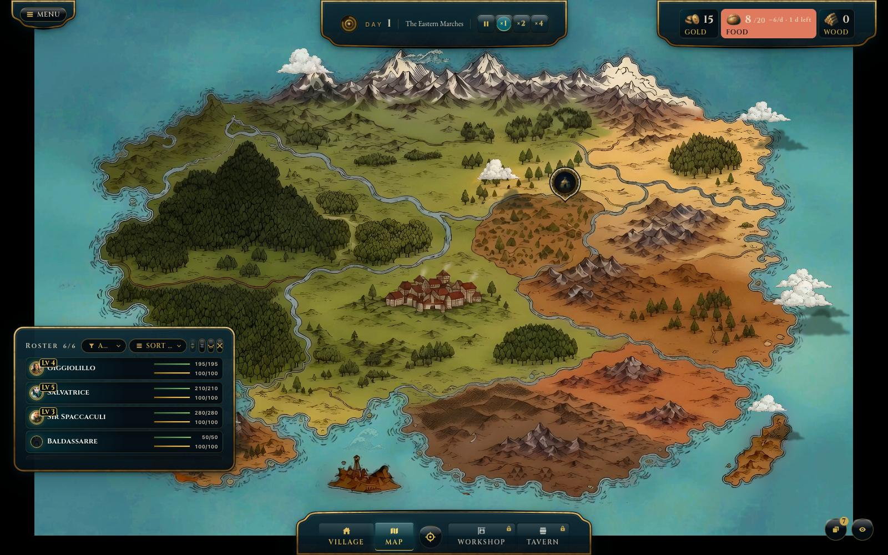

**Quando:** all'apertura di `/game`, dopo il velo di caricamento.
**Cosa c'è:** la mappa, il ribbon in alto (giorno, controlli tempo, risorse
oro/cibo/legna), il roster aperto col tasto **R**. I POI quest **compaiono da
soli** nei primi secondi (R-200: un marker ~1s dopo il veil, il successivo
~5s dopo — entrata sfalsata, mai scomparsi).
**Il test verifica:** il reveal avviene e l'oro del ribbon = l'oro dello store.

## 2. Il POI quest: reveal automatico + override Regia

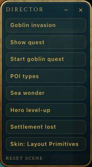

**Come:** **F10** apre il pannello Regia (solo build dev/playwright) →
**«Show quest»** — oggi un trigger **one-way** «reveal ora» (R-200): forza la
comparsa immediata di tutti i POI saltando lo stagger, e non li nasconde mai
più. I marker sono le offerte **reali** (goblin + rovine), mai esemplari demo
(R-143/R-180).

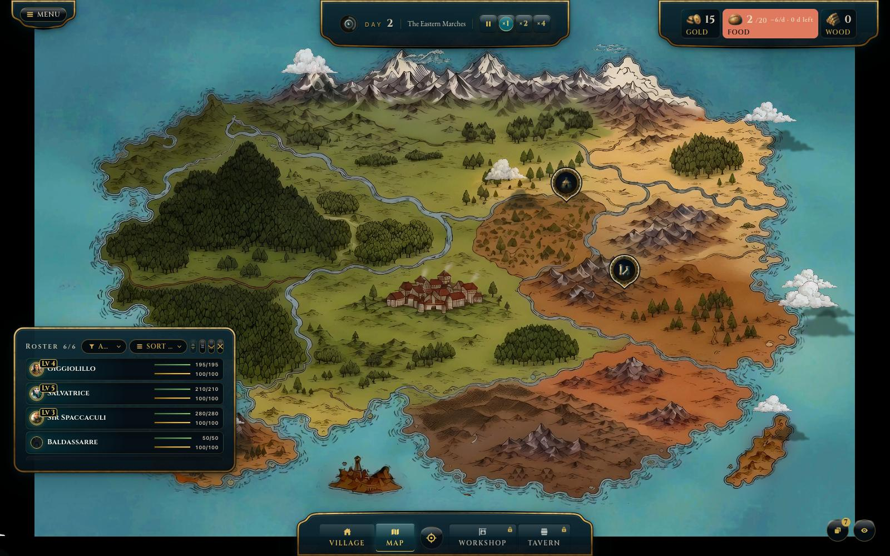

**Cosa succede:** il medaglione dorato entra in mappa con stato
`available` e sigillo vuoto (si riempirà col progresso della run).

## 3. Click sul POI → il quest planner

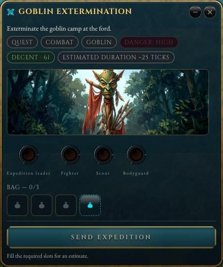

**Come:** click sul medaglione. Si apre il **POI detail** (`QuestExpeditionDetail`),
un'assemblea di **due lastre** che si trascinano come un pezzo unico
(R-195/PLAN-036): a sinistra il planner vero e proprio, a destra il **sidecar
del forecast** (una placca esterna, `quest-expedition-forecast-column`).
**Cosa mostra il planner:** sottotitolo + chip, subito sotto un **banner
cinematografico** (~2.76:1, `offer.coverArt` — qui il totem goblin), obiettivo,
tag, pericolo, tier di ricompensa (qui *Decent · 60* oro), durata stimata
(~110 tick), i **4 slot** (Capo spedizione obbligatorio; Combattente,
Esploratore, Guardia del corpo opzionali), la **bisaccia** e, in fondo e
sempre in vista, la CTA **«Send expedition»** (fuori dall'area di scroll).
**Cosa mostra il sidecar:** le **Stat Chiave** dell'offerta — *Primaria:
Forza, Secondaria: Percezione* per i goblin (`scenario.keyStats`) — poi il
forecast aggregato, il dettaglio per membro, il perché dei numeri e l'intel.
**Regole:** «Send expedition» resta **disabilitato** finché lo slot
obbligatorio è vuoto o il forecast non è pronto; sopra 720px di altezza il
planner non scrolla affatto (`minZeroScrollViewportHeightPx`, config).

**Il roster segue il detail (R-184):** aprendo un POI detail il roster si
apre da solo se era chiuso (il planner senza i PG da trascinare non serve);
quando il detail si chiude — con la X o con «Send expedition» — il roster
si richiude solo se l'aveva aperto il detail. Se lo avevi già aperto tu (tasto
**R**) resta com'era.

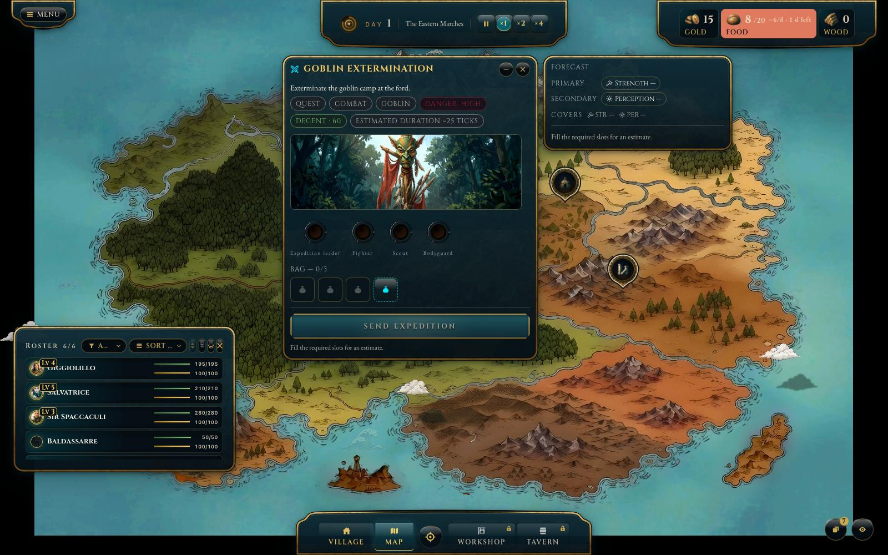

## 4. Il party: drag dal roster

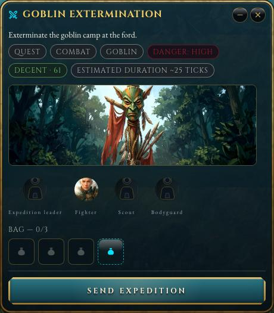

**Come:** si trascina la riga di un PG dal roster su uno slot. Ogni slot ha
un requisito di stat (es. Capo = *edge* o *fortitude*): se il PG non lo
soddisfa lo slot si illumina **invalid** e il drop viene rifiutato.
**Qui:** Mastro Beppe (popolano) è stato messo da capo e Sir Spaccaculi
(eroe) da combattente — apposta, per mostrare lo swap.
**Cosa succede a ogni cambio:** il **forecast** si ricalcola (Monte Carlo):
successo, ferite, morti, wipe, rischio per membro e da quale nodo arriva il
rischio; il segno `+N`/`−N` è la variazione rispetto alla formazione precedente.

> I popolani mostrano il ritratto-segnaposto (sagoma): non hanno ancora arte
> dedicata. Lo slot vuoto è invece la presa scura senza figura.

## 5. Swap slot ⇄ slot senza estrarre (R-183)

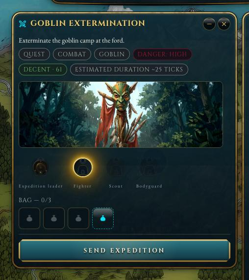

**Come:** si **trascina il ritratto già nello slot** su un altro slot.
- slot di arrivo **vuoto** → il PG si sposta;
- slot di arrivo **occupato** → i due PG si **scambiano**;
- nessuno dei due torna nel roster.

**Durante il drag:** il token originale si sbiadisce, un fantasma segue il
puntatore, e ogni altro slot si colora **valid**/**invalid** secondo una
sola domanda: *lo scambio rispetterebbe i requisiti di entrambi gli slot?*
**Estrarre resta possibile:** tenere premuto **fermo** sul ritratto
(~0,5 s) lo estrae come prima; appena il puntatore si muove è un drag.

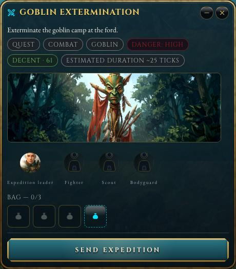

**Il test verifica:** dopo lo swap capo = Sir Spaccaculi, combattente =
Beppe, party sempre di 4; uno swap **vietato** (Lisetta, *precision*, sullo
slot del capo) viene rifiutato e la formazione non cambia.

## 6. Consumabili: cosa portare


**Come:** la bisaccia ha **3 slot** (`bag-slot-0..2`); un pulsante apre il
**picker esterno** `quest-bag-external-picker` — una placca a parte con le
tessere **solo-icona** degli oggetti reali del magazzino del villaggio
(`VILLAGE_STASH_CONFIG.items`). Ogni tessera ha un tooltip con **nome,
descrizione/effetto, stat coperte e stock**; una selezione riempie uno slot,
un click sullo slot pieno lo svuota; a borsa piena le tessere non scelte si
disabilitano. **Escape** chiude solo il picker e restituisce il focus al
pulsante. *Covers* mostra quali stat chiave della quest (qui Forza e
Percezione) sono coperte dai bonus scelti.
**Qui:** Strength bonus, Perception bonus, Healing.
**Effetti:** i bonus *+15 a un check* si usano armandoli in run; il cavallo
dimezza la durata; cura/pozione si usano dalla cintura.

## 7. «Send expedition»: la run parte

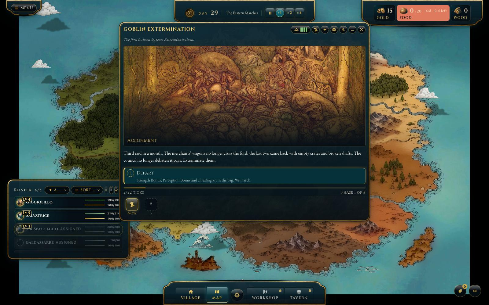

**Cosa succede al click (una sola scrittura):** party, stat, borsa, offerta
e programma dei nodi vengono **congelati** nella run; i 4 PG risultano
*fuori* (non assegnabili altrove, le ferite non guariscono in viaggio); il
POI passa a `in_progress` e il suo alone diventa l'orologio della spedizione;
si apre la **finestra della quest** (`QuestRunWindow`).
**Tempo:** il test porta il clock a **×4** dal ribbon in alto (pausa / ×1 /
×2 / ×4). Pausa = tutto congelato, comprese le fasi in viaggio.

## 8. La run, fase per fase

La finestra ha: titolo e icone (party, borsa, cronaca), il **teatro** con
l'immagine della fase, il testo, la **cintura**, le **scelte numerate**, la
barra del tempo e le **tessere delle fasi** (giocate · attuale · `?` prossima).
Le 8 fasi goblin: Assignment → Exploration → Treasure → Assault → Combat →
Pursuit → Raid → Return.

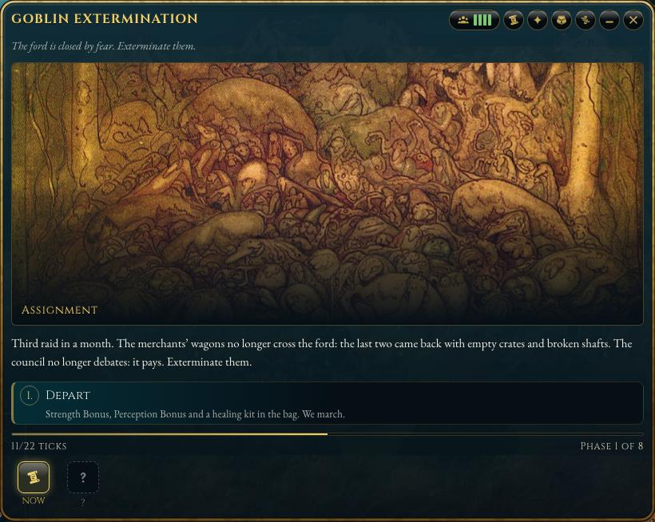

**Una fase con scelta (frontiera `waiting`)**: la run aspetta il giocatore.
Si sceglie con un click o con i tasti **1–9**. Ogni scelta con un check
mostra la probabilità di successo, di ferita e di morte.

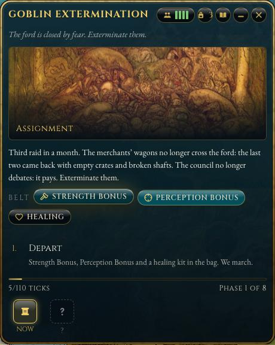

**La cintura (prima di un check o di una scelta, mai in azione libera):**
- **bonus** (Strength/Perception…): click = *armati* → il prossimo check
  che li riguarda li consuma e l'anteprima mostra `55% → 70%`;
- **Healing**: +20 HP al membro più malconcio (solo su un nodo di scelta);
- **Potion**: rimette in piedi un ferito.

Il test arma la cintura alla prima scelta e usa la cura quando qualcuno
ha perso HP.

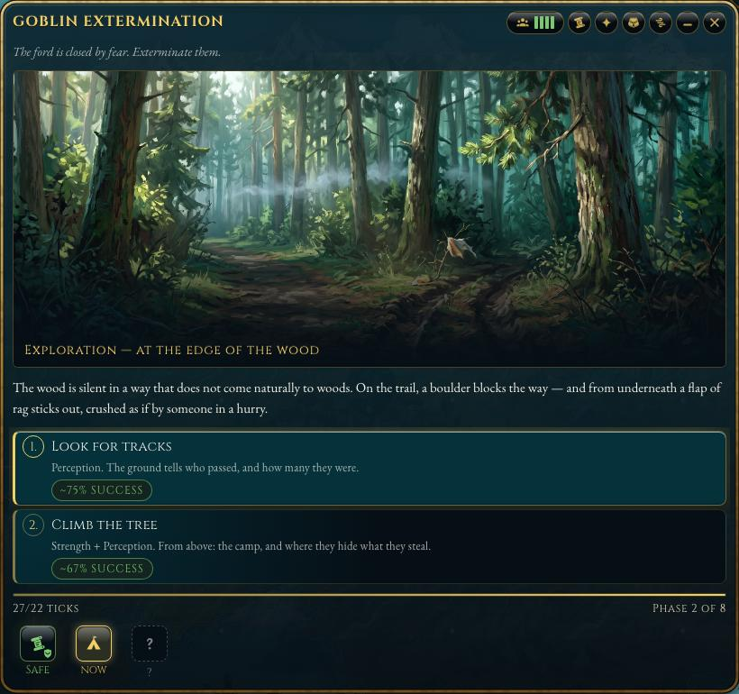

**Dopo la scelta — i beat:** il motore ha già deciso; la finestra
*racconta* le conseguenze un momento alla volta (scena, check, danno).
Mentre un beat è in scena le scelte sono bloccate: **Enter**, spazio o un
click avanzano.

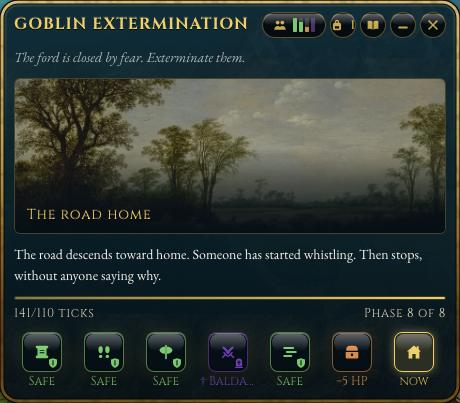

**Fase in viaggio (frontiera `pending`):** nessuna scelta; il nodo matura
sul **clock di gioco** (~10 tick per nodo) e il testo di transito fa da
respiro. Qui il giocatore non fa niente: aspetta, o accelera con ×2/×4.

## 9. Esito e rapporto di ritorno

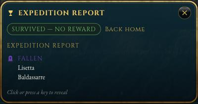

**Quando la run finisce** (esiti: `reward` · `survived` · `fled` · `wipe`) il
**settlement** applica le conseguenze **una sola volta** (anche dopo un
crash o un reload): oro, XP, ferite, morti, rilascio della borsa, e il party
torna «a casa». Finiti i beat compare il **rapporto**: prima i costi
(caduti, feriti, consumabili usati), poi il guadagno (ricompensa, bottino,
XP, informazioni).

| Esito | Ricompensa (offerta) | Bottino (oro della run) | XP |
|---|---|---|---|
| `reward` (obiettivo + capo vivo) | sì | sì | sì |
| `survived` / `fled` | no | sì | sì |
| `wipe` | no | no | no |

## 10. XP ai personaggi (R-183)

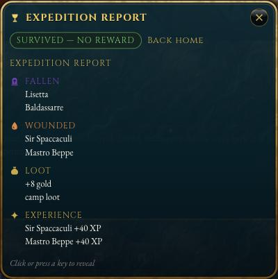

**Regola (default proposto, `QUEST_SETTLEMENT.residentXp.mode = 'full'`):**
ogni membro **vivo** al ritorno riceve tutta la XP della run; i caduti
nulla; su `wipe` nessuno. Il totale del villaggio continua a salire come
prima. In alternativa `split` divide la XP fra i sopravvissuti.
**Dove si vede:** nel rapporto (riga per PG), nel registro eventi
(«X ha guadagnato N PE»), sulla riga del roster (tooltip del nome
«Nome · N PE», attributo `data-resident-xp`).
**Cosa NON fa ancora:** livelli e curva XP sono aperti (`PROGRESSION.md`
§3): il numero si accumula ma non sblocca nulla.

## 11. Risorse nella HUD

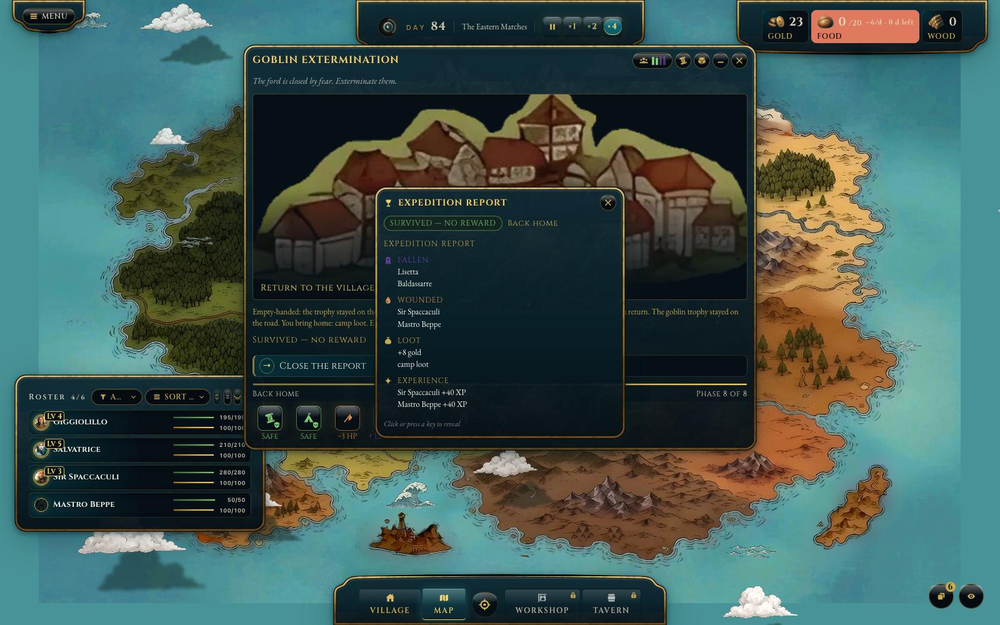

**Cosa cambia:** il readout **Gold** in alto a destra sale esattamente della
somma degli effetti oro del settlement (ricompensa + bottino); il test
confronta store e numero mostrato. Nel roster i feriti mostrano
«Recupero necessario» finché guariscono (a riposo, non in viaggio); i
caduti spariscono dai disponibili.
**Oggetti:** il bottino non-oro (es. il trofeo goblin) oggi compare solo
come riga del rapporto — non esiste ancora un inventario di villaggio
(vedi *Limiti*).

## 12. Chiusura: il POI ripetibile torna disponibile

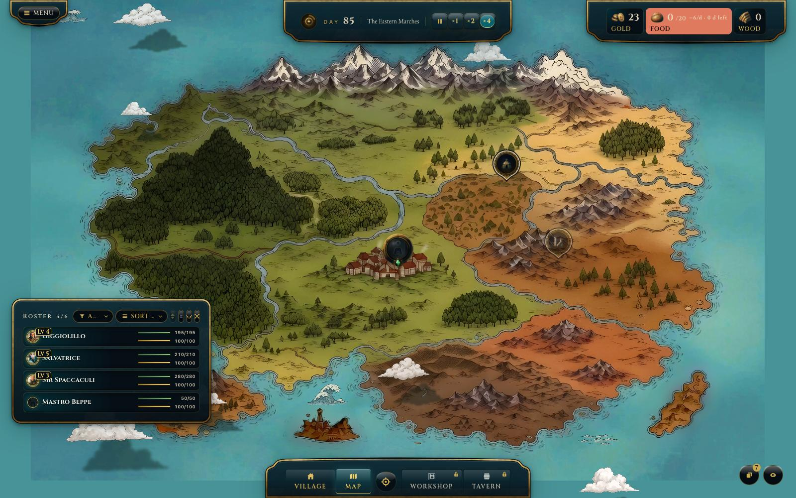

**Come:** «Close the report». **Cosa succede:** la finestra si chiude e la
run viene archiviata. Il POI goblin è authored **`repeatable`** (R-200 D-1):
**non viene consumato** — il marker resta sulla mappa e torna subito
`available`, pronto per essere rilanciato finché la sua finestra dura. (Un
POI one-shot come le Rovine invece lascia la mappa e al reload non torna:
finisce in `consumedPoiIds`, persistito.) Il test ricarica la pagina e
verifica che oro, XP dei PG e registro del villaggio siano ancora lì.

---

## Limiti noti (non coperti perché non esistono ancora)

- **Inventario consumabili:** il picker legge lo stock reale del magazzino
  (`VILLAGE_STASH_CONFIG`, qty per item) ma scegliere/usare un consumabile
  non scala ancora le quantità del villaggio.
- **Oggetti in HUD:** nessun inventario di villaggio — il loot goblin è già
  tutto convertito in oro; il trofeo resta una riga del rapporto.
- **Curva XP / livelli:** OPEN.
- **Ritratti dei popolani:** segnaposto.

## Bug trovati e corretti scrivendo questa suite

- **Dopo la prima quest il gioco non salvava più.** Lo schema delle righe del
  registro (`messageParams: z.record(...)` a un argomento) con zod 4 lanciava
  in validazione: ogni snapshot con una riga di settlement falliva il
  salvataggio, in silenzio (solo un warning in console). Al reload si
  ripartiva dall'ultimo salvataggio *prima* della quest.
- **Checksum dello snapshot instabile.** Calcolato sull'oggetto prima della
  validazione ma verificato dopo (zod riordina/scarta chiavi): un residente
  con `isOnExpedition` valorizzato faceva fallire il caricamento.

## Rigenerare le immagini

```bash
source ~/.nvm/nvm.sh && nvm use
QUEST_DOC_SHOTS=1 npx playwright test tests/e2e/idleVillage/gameQuestFullFlow.spec.ts --project="Desktop Chrome"
```

Viewport del test: 1600×1000. I nomi dei file sono fissi (`01-…` → `16-…`),
quindi questo documento resta valido senza modifiche finché il flusso non
cambia.
